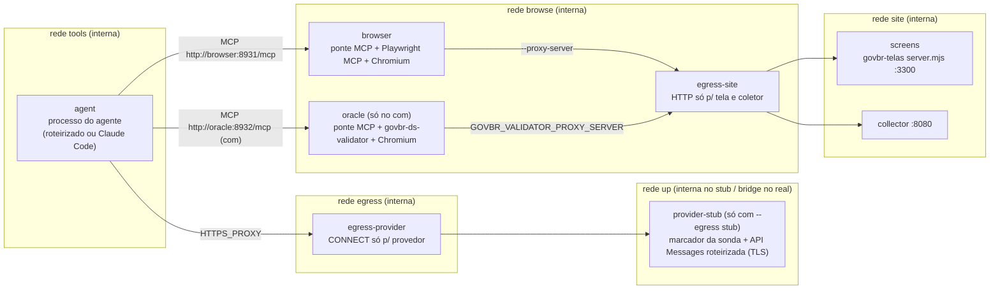

# Runner isolado de uma execução (T3a + T3b)

Plano: `thesis-workspace/planejamento/atual/plano-implementacao-benchmark-isolado-2026-10-02.md`,
itens T3, "Fronteiras de acesso e modelo de ameaça" e "Matriz mínima de provas". Contratos: D-64
(`contracts/`, `docs/contratos-benchmark.md`). Skill: D-68. Janela fixa: D-46/D-63 (NAT-32).

O T3a entrega a infraestrutura de **uma** execução isolada: imagens fixadas, redes, proxies, coletor,
ponte MCP com a trava da janela, sonda negativa e o comando `run-once`, tudo exercitado por um
**agente roteirizado** que não chama modelo nenhum.

O T3b (plano: `thesis-workspace/planejamento/atual/plano-t3b-cliente-real-2026-10-03.md`) liga o
**cliente real** (Claude Code 2.1.288, o binário da imagem, com os flags de produção) dentro das mesmas
paredes, contra um **dublê roteirizado da API Messages**: turnos escritos à mão, credencial falsa,
nenhum modelo. Prova as capacidades efetivas do cliente, o caminho MCP dele até a ponte, os hosts que
ele tenta, a telemetria e a entrega do texto — ver "Cliente real (T3b)".

> Um roteiro prova o **cliente e as paredes**, não o comportamento de um modelo. O que um modelo
> tenta, usa ou deixa de usar só a execução real mostra — ver "O que continua não verificado".

## Arquitetura

Por execução, tudo novo e rotulado `govbr.run=<runId>`; ao fim, tudo removido.



Todas as redes são `--internal` (sem rota para fora, sem DNS externo). A única exceção é a rede `up`
do proxy do provedor quando `--egress real` (padrão para `--agente claude`); com o agente roteirizado
o padrão é `--egress stub`: um dublê com os aliases `api.anthropic.com`/`platform.claude.com` numa
rede interna — o caminho permitido é provado sem tocar a internet.

### Quem alcança o quê

| Contêiner | Alcança | Não alcança (provado pela sonda e/ou pelo agente roteirizado) |
|---|---|---|
| `agent` | as duas pontes MCP; o proxy do provedor (só CONNECT para a allowlist) | internet direta (IPv4, IPv6, por nome), DNS externo, host do Docker (`host.docker.internal`, `gateway.docker.internal`, 192.168.65.x, gateways de cada rede, 172.17.0.1) em qualquer porta, loopback v4/v6, portas do painel antigo (3000/4000/4100–4102), **a tela e o coletor diretamente**, socket do Docker, HOME pessoal, sentinelas no host, saída de outra execução, escrita fora de `/out` |
| `browser` (Chromium) | só `screens:3300` e `collector:8080`, pelo `egress-site` | `file://` (recusado pela ponte), internet, host, loopback (o Playwright força o loopback pelo proxy), as próprias portas de controle, o oráculo |
| `oracle` (com) | só `screens:3300`, pelo `egress-site` (+ `GOVBR_VALIDATOR_ALLOWED_ORIGINS`) | o resto, como o navegador |
| `screens`, `collector` | nada além da rede `site` | — |

O processo do agente **não** alcança a tela nem o coletor: só o navegador alcança (a skill manda
enviar o relatório pela página do coletor). É mais estreito que "o agente alcança tela e coletor por
nomes fixos" do pedido do T3a — decisão registrada aqui; nada na tarefa precisa do caminho direto.

### Contêineres: flags comuns

`--read-only`, `--tmpfs /tmp` e `--tmpfs /home/runner` (dono 10001, modo 700), `--cap-drop ALL`,
`--security-opt no-new-privileges`, `--user 10001:10001`, `--pids-limit`, `--memory 2g`, `--init`.
Sem `--privileged`, sem rede do host, sem socket do Docker. Montagens: só a subpasta de saída de cada
papel (`/out`, escrita) e, no agente e na sonda, `/run/task` só-leitura (texto da tarefa e
configuração MCP). Nenhuma credencial em imagem ou montagem; o cliente real a recebe só por variável
de ambiente, e só com `--permitir-modelo` (no modo dublê, um valor falso fixo; ver "Cliente real (T3b)").

### Imagens (fixadas, sem `latest`)

Construídas por `npm run runner:imagens` (contexto montado por lista explícita); `runner/images.lock.json`
guarda o id de cada uma e as versões medidas de dentro dela. O preflight recusa imagem diferente.

| Imagem | Conteúdo |
|---|---|
| base | `node:24-bookworm-slim@sha256:0e0ff40c…` (Node 24.21.0 LTS) |
| `govbr-runner-screens` | `server.mjs`, `site/`, `site-manifest.json` do govbr-telas; o servidor recusa partir se um byte divergir |
| `govbr-runner-agent` | `@playwright/mcp@0.0.70` (o das baterias antigas) + Chromium dele, `@modelcontextprotocol/sdk@1.29.0`, `@anthropic-ai/claude-code@2.1.288` (instalado, não executado no T3a), ponte, sonda e agente roteirizado |
| `govbr-runner-oracle` | a imagem do agente + `dist/`, `data/` e `package*.json` do govbr-ds-validator (2.7.0), `npm ci --omit=dev`, Chromium do Playwright 1.61.1 |
| `govbr-runner-collector` | coletor + Ajv 8.20.0 + `common`/`findings` v1 copiados de `contracts/` |
| `govbr-runner-egress` | proxy com allowlist e o dublê do provedor (só módulos nativos; o dublê separa TLS × marcador pelo 1º byte) |

`govbr-telas/.node-version` passou a 24.21.0 (`export-telas-1.2.0`); `site/` saiu idêntico byte a byte.

## Allowlist do provedor

| Host | Situação |
|---|---|
| `api.anthropic.com:443` | único host da allowlist. Exercitado pelo cliente real contra o dublê (T3b), com chave de API falsa e com token OAuth falso: `POST /v1/messages`, `GET /api/claude_code/settings` e `GET /api/claude_code/policy_limits` (as duas últimas: configuração remota do cliente; o dublê responde 404 e o cliente segue) |

`platform.claude.com` **saiu** da allowlist no T3b: o cliente não o tentou com nenhum dos dois tipos de
credencial por variável de ambiente (testes `cliente real sem/com` e `cliente real 529`; o dublê mantém
esse alias, então uma tentativa apareceria como recusa no log do proxy, não como falha de DNS). Uma
credencial válida pode abrir outros caminhos: a prova real do piloto lê o mesmo log (`hosts-do-cliente`).

Fora de propósito: `claude.ai`, `claude.com`, `platform.claude.com` (login interativo), `downloads.claude.ai`,
`registry.npmjs.org`, `mcp-proxy.anthropic.com`, telemetria (`*.datadoghq.com`), `storage.googleapis.com`,
`github.com`. A imagem fixa `CLAUDE_CODE_DISABLE_NONESSENTIAL_TRAFFIC=1`, `DISABLE_TELEMETRY=1`,
`DISABLE_ERROR_REPORTING=1`, `DISABLE_AUTOUPDATER=1`.

## Trava da janela (D-63/NAT-32)

O Playwright MCP parte com `--viewport-size` fixo e o agente fala com ele só pela ponte
(`runner/container/bridge.mjs`), que aplica três camadas:

1. **Ferramenta ausente.** A ponte anuncia uma allowlist de 18 ferramentas do Playwright MCP.
   `browser_resize` e `browser_run_code` (código Playwright com `page`, capaz de `setViewportSize` e
   CDP) ficam ocultas, assim como `browser_file_upload`, `browser_install` e qualquer ferramenta nova de
   versões futuras. Chamá-las pelo nome devolve erro e grava `refused / ferramenta-oculta`.
2. **Tentativa indireta recusada e registrada.** `browser_evaluate` roda no contexto da página (não
   alcança o Playwright), mas o texto da função é conferido: `resizeTo`, `setViewportSize`,
   `Emulation.*`, atribuição de `zoom`, `devicePixelRatio` etc. são recusados com `refused / janela-fixa`.
3. **Medição depois de cada chamada.** A ponte mede `innerWidth × innerHeight` da página ativa depois
   de cada chamada encaminhada; qualquer diferença do tamanho fixado grava `drift`, e o check
   `janela-sem-deriva` do `isolation.json` falha. Pega o caminho que as duas primeiras camadas não previram.

Por que a ponte e não só omitir ferramentas na configuração: o registro tem de ser escrito por quem
o agente não controla, e a tentativa tem de aparecer como dado (não some silenciosamente).

**Outras larguras (meio declarado).** Uma instância do Playwright MCP por largura declarada, cada uma
com o próprio navegador de tamanho fixo; a ponte expõe `browser_select_window { width }` para trocar
a instância ativa. `{{MEIO_LARGURAS}}` é preenchido pelo runner com esse meio quando há mais de uma
largura (`runner/telas-runner.json` ou `--larguras`). As duas telas declaram hoje só 1280×900.

## Coletor

Um contêiner novo por execução, armado por ambiente com UM run id (o agente não o escolhe nem o vê
no texto da tarefa). `POST /api/submit` com o relatório; o coletor monta o envelope `findings.v1` e
o valida (schema estrito). Recibo mínimo `{ ok, receipt }`. Sem listagem nem leitura (404). Caminho
com `..`/`%2e`/`%2f`/barra invertida → 400; `x-govbr-run-id` diferente → 409; relatório idêntico ao
aceito → 200 `duplicate` (idempotente); diferente → 409 (sem sobrescrita); acima de 2 MB → 413;
JSON inválido ou fora do schema → 400 e corpo arquivado em `refused/`.

## Ciclo do `run-once`

```sh
# agente roteirizado (T3a)
npm run run-once -- --tela solicitacao --braco sem --agente fake --cenario honesto --limite-min 90 --saida <pasta-nova>
# cliente real contra o dublê roteirizado (T3b; sem modelo, credencial falsa, fixture)
npm run run-once -- --tela solicitacao --braco com --agente claude --egress stub --cenario honesto   --modelo claude-opus-duble-teste --esforco high --limite-min 5 --saida <pasta-nova>
# cliente real contra o provedor real (piloto; só do terminal da autora, com UMA credencial no ambiente)
npm run run-once -- --tela solicitacao --braco sem --agente claude --egress real --permitir-modelo   --modelo <id-exato> --esforco high --limite-min 90 --saida <pasta-nova>
```

1. **Preflight** (`integrity`): Docker; id de cada imagem = lockfile; `site-manifest.json` = o
   embutido na imagem das telas; skill do pacote = skill do instrumento; texto da tarefa renderizado
   (`render-task-prompt`) sem vocabulário proibido; no com, `dist/`+`data/` do validador = o embutido;
   no `--agente claude`: esforço aceito pelo cliente; com `--egress real`, `--permitir-modelo` + exatamente
   uma credencial; com `--egress stub`, roteiro conhecido e **sem** `--permitir-modelo`. Falhou →
   `run.json` `not-run`, nenhum contêiner.
2. **Infraestrutura nova**: 5 redes internas, contêineres, prontidão pelos logs.
3. **Controles positivos do controlador**: sentinelas plantadas no host (`TCC/.govbr-sentinelas/<runId>/…`,
   arquivos falsos, apagados ao fim) legíveis pelo controlador; servidor-sentinela no loopback do host
   alcançado por um contêiner comum na rede `bridge` padrão (o alvo existe e é alcançável fora da
   política); `/etc/hostname` existe no contêiner do navegador; tela e coletor respondem pelo proxy;
   as pastas de outras execuções existem.
4. **Sonda negativa** (`probe.mjs`): mesma imagem, flags, montagens, redes e ambiente do agente; tenta
   cada capacidade proibida. Check obrigatório falho ou controle positivo falho → `not-run` /
   `isolation-failed`, o agente não parte.
5. **Agente**, com limite de relógio; estourou → `docker kill` do grupo inteiro, `interrupted/timeout`.
6. **Coleta e desmontagem**: logs, saídas de cada papel; remoção de todos os contêineres e redes
   (perfil do navegador, storage, mocks e tmpfs morrem com eles), conferida (`desmontagem`).
7. **Pacote**: `run.json`, `findings.json` (se aceito), `isolation.json`, `tool-events.ndjson`,
   `artifact-manifest.json`, `refused/`, `evidence/` (preflight, prompt, configuração MCP,
   configuração efetiva dos contêineres, logs, brutos de cada papel). Validado com `validateContract`
   e `crossCheckRun`; problema → código 2.

Códigos de saída: 0 passed, 3 failed/interrupted, 4 not-run, 2 pacote inválido, 1 erro de uso.
Execução do agente roteirizado ou do cliente real contra o dublê grava `fixture: true` (nunca dado científico).

## Cliente real (T3b)

Código: `runner/cliente-claude.ts` (comando, roteiros, telemetria, gate de aderência),
`runner/container/stub.mjs` (dublê), `runner/container/tls-cert.mjs` (CA de teste por execução).

### Comando (igual nos dois braços e nos modos dublê e real)

```sh
sh -c 'cd "$HOME" && exec claude "$@" < /run/task/prompt.txt > /out/claude-stream.ndjson' claude \
  -p --input-format text --output-format stream-json --verbose --model <id> --effort <nível> \
  --mcp-config /run/task/mcp.json --strict-mcp-config --setting-sources "" \
  --tools "" --allowedTools mcp__playwright,mcp__govbr-ds-validator --disallowedTools Bash,Read,Write,…(27 nomes) \
  --disable-slash-commands --no-session-persistence --permission-mode dontAsk
```

- `--tools ""` é o que desliga as ferramentas internas (o cliente as remove da sessão e responde
  "No such tool available … disabled for this session"); `--disallowedTools` é a segunda trava.
- O texto da tarefa vai por **stdin redirecionado do arquivo montado só-leitura**: não aparece no
  `docker inspect` nem na linha de comando. Chega ao modelo como a 1ª mensagem do usuário, byte a byte
  (provado pelo hash no pedido ao dublê, inclusive o `\n` final).
- O esforço pedido (`--esforco`) agora chega ao cliente (`--effort`); antes só era registrado.
- `cd "$HOME"`: o diretório de trabalho do cliente é o HOME vazio (tmpfs), não `/opt/runner`.
- A credencial entra só por variável de ambiente (`-e NOME`, valor herdado do runner, nunca na
  linha de comando) e o valor é **redigido** na configuração efetiva arquivada (`NOME=<redigido>`).

### Dois modos

| | `--egress stub` (testes) | `--egress real` (piloto) |
|---|---|---|
| Provedor | dublê roteirizado nos aliases `api.anthropic.com`/`platform.claude.com`, rede interna | `api.anthropic.com` pelo proxy, rede `up` com saída |
| Credencial | valor falso fixo (`sk-ant-…-FALSO-nao-e-credencial`); o ambiente do runner **não** é repassado (testado com uma sentinela no ambiente) | exatamente uma de `ANTHROPIC_API_KEY`/`CLAUDE_CODE_OAUTH_TOKEN` |
| Autorização | recusa `--permitir-modelo` | exige `--permitir-modelo` |
| Registro | `fixture: true`, `provider.name: "stub"` | `fixture: false`, `provider.name: "anthropic"` |
| Diferença no caminho | `NODE_EXTRA_CA_CERTS=/run/task/provider-ca.pem` (CA de teste gerada por execução, em JS puro; a chave da CA nunca é gravada; a do servidor fica fora do pacote) | — |

Por que atrás do proxy e não `ANTHROPIC_BASE_URL`: assim o cliente fala TLS com `api.anthropic.com`
pelo `HTTPS_PROXY` exatamente como em produção, e o log do proxy mostra **quais hosts ele tenta**.

O dublê não é modelo: devolve, por turno do laço principal (identificado pelo hash do texto da
tarefa), o que o roteiro manda — blocos `tool_use`, texto, ou erro HTTP — com uso de tokens fixo e
conhecido; pedidos auxiliares recebem "ok". Grava cada pedido (`evidence/raw/provider-stub/`): host,
caminho, nomes de cabeçalho, **tipo** de credencial (nunca o valor), ferramentas anunciadas, resultados
de ferramenta e o 1º pedido inteiro. Roteiros: `honesto` (ferramentas proibidas → navegação → oráculo no
com → envio pelo navegador), `erros`, `429`, `529`.

### O que o pacote ganha

- `evidence/cliente.json`: o evento `init` do cliente (ferramentas, servidores MCP e estado, plugins,
  agentes, skills, comandos, origem da credencial), modelos devolvidos, usos e erros de ferramenta,
  novas tentativas de API (`system/api_retry`), o evento `result`; no dublê, o resumo dos pedidos; e os
  túneis que o proxy do provedor abriu **depois** de o agente partir.
- `evidence/aderencia-oraculo.json` (toda execução que rodou): o gate do plano. **Com**: ≥ 1 consulta
  normativa ok + ≥ 1 scan ok + verificação quando há candidato aplicável (achado com `rule`) e
  `verify_finding` existe; sem cota. Qualquer chamada do oráculo com erro → `used-with-errors`; nenhuma
  → `available-unused`; usada sem cumprir o gate → `unverified`. **Sem**: `absent-verified` pelo
  inventário, DNS, ponte e chamadas.
- `run.json`: `model.resolved` = o `model` das respostas (fonte `client-log`, nunca copiado do pedido);
  tokens e turnos do `result` do cliente; `estimatedCostUsd` = estimativa do próprio cliente a preço de
  referência (nunca fatura; `billedCostUsd` fica indisponível).
- Checks novos no `isolation.json`: `ferramentas-do-cliente` (init e campo `tools` dos pedidos = só as
  ferramentas MCP das pontes; sem: navegador; com: + oráculo), `extensoes-do-cliente` (sem skills,
  comandos, plugins instalados ou servidores MCP além dos configurados, todos conectados),
  `texto-da-tarefa-entregue` (só observável no dublê), `hosts-do-cliente` (informativo).
- Erro de API relatado pelo cliente: 429 → `interrupted`/`rate-limited`; 529/503 → `interrupted`/
  `model-unavailable`; 401/403 → `failed`/`auth-failed`. Nunca "zero achados"; artefatos preservados.

### Comportamento do cliente 2.1.288 observado (medido contra o dublê)

- Anuncia uma ferramenta adiada `DeferredToolPlaceholder` (`defer_loading: true`, "never call this
  tool"); sem ferramenta de busca, o modelo não a carrega, e chamá-la devolve "No such tool". Qualquer
  outra ferramenta adiada reprova `ferramentas-do-cliente`.
- Traz dois plugins **embutidos** (`cc-plugin-agents-md@builtin`, `cc-plugin-plugin-authoring@builtin`) e
  a lista de agentes padrão (`general-purpose`, `Explore`, `Plan`…), mas sem `Task`/`Agent`, sem skills
  e sem comandos nenhum deles é alcançável. Ficam registrados no `init`.
- Acrescenta, depois da tarefa, uma mensagem de sistema com o ambiente: diretório, plataforma, **versão
  do kernel do host** (WSL2 aqui), o id do modelo e a data. Igual nos dois braços (teste de paridade:
  mensagens e prompt de sistema do 1º pedido iguais); muda de uma máquina/dia para outro.
- 429: respeita `x-should-retry: false`; sem ele, 10 novas tentativas em ~3 min. 529: ignora o
  cabeçalho e faz 10 novas tentativas (~185 s); `CLAUDE_CODE_MAX_RETRIES` limita (o roteiro `529` usa 2).
  Em produção vale o padrão do cliente; as tentativas aparecem na telemetria.
- `model` desconhecido gera só um aviso no stderr (`unrecognized_model`).

## Testes

`npm run test:runner` (Docker obrigatório; sem Docker, pula com aviso). **Agente roteirizado (T3a)**,
nos dois braços onde faz sentido: honesto (1 achado), vazio (`findings: []`), sem envio
(`none`/`no-submission`), malformado (recusado, corpo arquivado), proibido (cada tentativa recusada e
registrada pela ponte, pelos proxies e pelo coletor; controles positivos), estado entre execuções
(marcador em localStorage, cookie, `/tmp` e HOME da 1ª ausente na 2ª; impressão digital inicial igual),
limite de tempo (grupo morto, evidência preservada), larguras declaradas, preflight falho (nenhum
contêiner), cliente real (provedor real) sem autorização, saída real do proxy do provedor, e paridade
entre braços (texto igual byte a byte; configuração efetiva de todos os contêineres igual; o com só
acrescenta o contêiner e a entrada MCP do oráculo; `run.json` difere só na allowlist).

**Cliente real contra o dublê (T3b)**, nenhum modelo:

| Caso | Prova |
|---|---|
| `cliente real sem` / `com` | 23/22 ferramentas proibidas pedidas (internas, ocultas pela ponte, oráculo no sem) voltam como erro e nunca chegam à ponte; `init` e campo `tools` = só MCP das pontes; cada chamada MCP do cliente aparece nos eventos da ponte; só `api.anthropic.com` com chave falsa (a sentinela do ambiente do runner não vaza; nenhum segredo nem chave privada no pacote); modelo ecoado, tokens = soma do dublê; texto da tarefa íntegro; `used-adherent`/`absent-verified`; isolamento `passed` com a sonda antes |
| `cliente real: paridade` | texto, configuração efetiva e `run.json` como no T3a; mensagens e prompt de sistema do 1º pedido ao modelo iguais nos dois braços |
| `cliente real erros com` | recusa da ponte (janela, `file:`), `isError` do Playwright, erro do oráculo → `used-with-errors`; truncamento do registro marcado; erros devolvidos ao modelo listados |
| `cliente real 429` | `interrupted`/`rate-limited`, `submission: none`, artefatos e tokens preservados |
| `cliente real 529` (token OAuth falso) | `interrupted`/`model-unavailable`, 2 novas tentativas na telemetria; com OAuth também só `api.anthropic.com` (Bearer) |
| `modo dublê recusa…` | `--permitir-modelo` e roteiro desconhecido → `not-run`, nenhum contêiner |

## O que está provado e o que continua não verificado

**Provado com o agente roteirizado (T3a)**, pelo caminho completo e pelos registros do harness: as
paredes de rede e de arquivo dos contêineres, a allowlist dos dois proxies, a trava da janela nas três
camadas, a ausência do oráculo no sem (inventário, DNS, ponte e chamadas), o contrato do coletor, o
reset de estado entre execuções, o limite de tempo e o pacote validado.

**Provado com o cliente real contra o dublê (T3b)** — eram os itens 1–7 da lista anterior:

1. Capacidades efetivas do Claude Code 2.1.288 com os flags do `run-once`: nenhuma ferramenta interna
   (Bash, Read, Write, Edit, NotebookEdit, Glob, Grep, WebFetch, WebSearch, Task/Agent, Skill,
   ToolSearch, recursos MCP…) existe na sessão; nenhum plugin instalado, skill, comando ou servidor MCP
   além dos configurados; HOME vazio. *Pelo cliente*, não pela recusa de um modelo.
2. Hosts: com chave de API **e** com token OAuth (ambos falsos), só `api.anthropic.com`;
   `platform.claude.com` nunca tentado e retirado da allowlist.
3. O cliente MCP HTTP do Claude Code fala com a ponte; os eventos são escritos pela ponte.
4. Telemetria: modelo resolvido (do `model` das respostas), tokens, turnos, custo estimado, erros de
   ferramenta (recusa da ponte, `isError`, erro do oráculo, truncamento do registro) e reação a 429/529.
5. Texto da tarefa: stdin a partir do arquivo montado, íntegro byte a byte e igual nos dois braços.
6. Gate de aderência do oráculo calculado das chamadas reais do cliente, registradas pela ponte.
7. As paredes do T3a valem com o cliente real: a sonda roda antes e o isolamento passa.

**Continua não verificado — só a execução real (prova controlada do piloto, T5) mostra:**

- O comportamento do **modelo**: se usa as ferramentas, se tenta caminhos proibidos, se envia o relatório.
- Identidade efetiva do modelo, tokens e custo **reais**; retries reais do provedor; latência.
- Autenticação real (assinatura) e hosts que só aparecem com credencial válida (ex.: as rotas
  `/api/claude_code/organizations|skills|metrics` que o binário conhece e o dublê nunca viu). O log do
  proxy (`hosts-do-cliente`) e `extensoes-do-cliente` registram o que aparecer; `/settings` e
  `/policy_limits` podem devolver **configuração gerenciada** do lado do provedor com credencial real —
  conferir o `init` da prova real.
- Timeout de ferramenta (a ponte corta em 120 s com `transport-error`; não exercitado) e truncamento de
  resultado grande do lado do cliente.
- A prova real não reutiliza a sessão da autora: HOME é tmpfs novo, `--no-session-persistence`.
