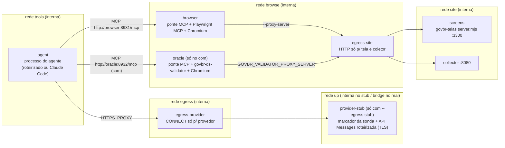

# Runner isolado de uma execução (T3a + T3b)

Plano: `thesis-workspace/planejamento/atual/plano-implementacao-benchmark-isolado-2026-10-02.md`,
itens T3, "Fronteiras de acesso e modelo de ameaça" e "Matriz mínima de provas". Contratos: D-64
(`contracts/`, `docs/contratos-benchmark.md`). Skill: D-68. Janela fixa: D-46/D-63 (NAT-32).

O T3a entrega a infraestrutura de **uma** execução isolada: imagens fixadas, redes, proxies, coletor,
ponte MCP com a trava da janela, sonda negativa e o comando `run-once`, tudo exercitado por um
**agente roteirizado** que não chama modelo nenhum.

O T3b (plano: `thesis-workspace/planejamento/atual/plano-t3b-cliente-real-2026-10-03.md`) liga o
**cliente real** (Claude Code 2.1.288, o binário da imagem, com os flags de produção) dentro das mesmas
paredes, contra um **dublê roteirizado da API Messages**: turnos escritos à mão, credencial falsa,
nenhum modelo. Prova as capacidades efetivas do cliente, o caminho MCP dele até a ponte, os hosts que
ele tenta, a telemetria e a entrega do texto — ver "Cliente real (T3b)".

> Um roteiro prova o **cliente e as paredes**, não o comportamento de um modelo. O que um modelo
> tenta, usa ou deixa de usar só a execução real mostra — ver "O que continua não verificado".

## Arquitetura

Por execução, tudo novo e rotulado `govbr.run=<runId>`; ao fim, tudo removido.



Todas as redes são `--internal` (sem rota para fora, sem DNS externo). A única exceção é a rede `up`
do proxy do provedor quando `--egress real` (padrão para `--agente claude`); com o agente roteirizado
o padrão é `--egress stub`: um dublê com os aliases `api.anthropic.com`/`platform.claude.com` numa
rede interna — o caminho permitido é provado sem tocar a internet.

### Quem alcança o quê

| Contêiner | Alcança | Não alcança (provado pela sonda e/ou pelo agente roteirizado) |
|---|---|---|
| `agent` | as duas pontes MCP; o proxy do provedor (só CONNECT para a allowlist) | internet direta (IPv4, IPv6, por nome), DNS externo, host do Docker (`host.docker.internal`, `gateway.docker.internal`, 192.168.65.x, gateways de cada rede, 172.17.0.1) em qualquer porta, loopback v4/v6, portas do painel antigo (3000/4000/4100–4102), **a tela e o coletor diretamente**, socket do Docker, HOME pessoal, sentinelas no host, saída de outra execução, escrita fora de `/out` |
| `browser` (Chromium) | só `screens:3300` e `collector:8080`, pelo `egress-site` | `file://` (recusado pela ponte), internet, host, loopback (o Playwright força o loopback pelo proxy), as próprias portas de controle, o oráculo |
| `oracle` (com) | só `screens:3300`, pelo `egress-site` (+ `GOVBR_VALIDATOR_ALLOWED_ORIGINS`) | o resto, como o navegador |
| `screens`, `collector` | nada além da rede `site` | — |

O processo do agente **não** alcança a tela nem o coletor: só o navegador alcança (a skill manda
enviar o relatório pela página do coletor). É mais estreito que "o agente alcança tela e coletor por
nomes fixos" do pedido do T3a — decisão registrada aqui; nada na tarefa precisa do caminho direto.

### Contêineres: flags comuns

`--read-only`, `--tmpfs /tmp` e `--tmpfs /home/runner` (dono 10001, modo 700), `--cap-drop ALL`,
`--security-opt no-new-privileges`, `--user 10001:10001`, `--pids-limit`, `--memory 2g`, `--init`.
Sem `--privileged`, sem rede do host, sem socket do Docker. Montagens: só a subpasta de saída de cada
papel (`/out`, escrita) e, no agente e na sonda, `/run/task` só-leitura (texto da tarefa e
configuração MCP). Nenhuma credencial em imagem ou montagem; o cliente real a recebe só por variável
de ambiente, e só com `--permitir-modelo` (no modo dublê, um valor falso fixo; ver "Cliente real (T3b)").

### Imagens (fixadas, sem `latest`)

Construídas por `npm run runner:imagens` (contexto montado por lista explícita); `runner/images.lock.json`
guarda o id de cada uma e as versões medidas de dentro dela. O preflight recusa imagem diferente.

| Imagem | Conteúdo |
|---|---|
| base | `node:24-bookworm-slim@sha256:0e0ff40c…` (Node 24.21.0 LTS) |
| `govbr-runner-screens` | `server.mjs`, `site/`, `site-manifest.json` do govbr-telas; o servidor recusa partir se um byte divergir |
| `govbr-runner-agent` | `@playwright/mcp@0.0.70` (o das baterias antigas) + Chromium dele, `@modelcontextprotocol/sdk@1.29.0`, `@anthropic-ai/claude-code@2.1.288` (instalado, não executado no T3a), ponte, sonda e agente roteirizado |
| `govbr-runner-oracle` | a imagem do agente + `dist/`, `data/` e `package*.json` do govbr-ds-validator (3.2.0), `npm ci --omit=dev`, Chromium do Playwright do validator. **Só busca léxica padrão** (ver abaixo) |
| `govbr-runner-collector` | coletor + Ajv 8.20.0 + `common`/`findings` v1 copiados de `contracts/` |
| `govbr-runner-egress` | proxy com allowlist e o dublê do provedor (só módulos nativos; o dublê separa TLS × marcador pelo 1º byte) |

**Oráculo ≥ 3.2.0: só a busca léxica padrão (NAT-100).** O validator 3.2.0 tem busca híbrida opcional
(modelo ONNX local em `data/models/<id>/`, ~377 MB, fora do git). A imagem da bateria serve só o padrão
léxico (idêntico ao 3.1.0): de `data/` saem o que o git do validador ignora (pesos dos modelos, vetores de
candidatos) e `data/retrieval/embeddings/` (versionado, mas a léxica não lê; sem ele a busca densa não
sobe). Fica `data/models/models.json` (+ licença, 7 KB): sem ele um `retrieval:"hybrid"` pedido numa
chamada lançaria; com ele, a resposta cai na léxica e diz `ranking.dense:"unavailable"`. O build falha se
a imagem definir algum `GOVBR_RETRIEVAL_*` ou contiver dado denso; o `run-once` não passa nenhum ao
contêiner (`test:runner` confere). Etiquetas: `govbr.oracle.commit` (validador sem mudança local em
`src/`, `data/`, `package*.json`), `govbr.oracle.retrieval-mode=lexical-default`,
`govbr.oracle.image-data-sha256` (o `data/` embutido) e `govbr.oracle.image-data-excluded`.
`govbr.oracle.data-sha256` / `versions.oracle.dataSha256` continuam o hash do `data/` do validador no host,
inteiro — é o que o preflight recalcula; baixar ou apagar os modelos no host muda esse hash e o preflight
recusa até reconstruir a imagem (falha fechada).

**Oráculo 3.4.x / 3.5.0 / 3.6.x (NAT-100).** Desde a 3.3.0 (D-152) o validator não tem mais busca densa nem
`data/models/`; a conferência do build aceita a pasta ausente. A imagem `govbr-runner-oracle:3.4.1-fae724d1127a`
foi construída de um clone limpo no commit `e15b1b1` (3.4.1; tools/list igual ao da 3.4.0, pins `TOOLS_LIST_SHA256_3_4_0`) (`npm ci` + `tsc`, sem `dist/` antigo nem modelos no
`data/`), o mesmo estado que o checkout por SHA do CI produz: `GOVBR_VALIDATOR_DIR=<clone>` no build e no
`run-once`/testes. O checkout de trabalho do validator só serve ao preflight se o `dist/` e o `data/` dele
forem os do commit (sem arquivos de builds antigos nem `data/models/`).
Rodada 3.7.10 (lock de 2026-11-11T05:58, a das campanhas `dev-3710-*`): `govbr-runner-oracle:3.7.10-baaf4932a72f`
(`sha256:86f916f2…`, commit `edb10cd`, dist `baaf4932…`, `dataSha256` `b4b2eceb…` igual; da 3.7.8 à 3.7.10 nenhuma foi a
campanha: D-190 estados recolhidos com receita e upload-paths também no knowledge-free; 3.7.9 forma só-ids com código e
seletor, estado já visto nasce fechado, scan parcial não fecha, nada atrás de diálogo modal; 3.7.10 checks do mesmo estado
somados e `omitted[].alreadyMeasuredIn`), sobre a base do agente `…-c90c12ac81308`, construída com `--so oracle` de uma
worktree destacada limpa (`.tmp-eval/validator-3710r`, `npm ci` + `tsc` com `dist/` apagado antes) por
`.tmp-eval/trocar-oraculo.sh <sha>` (worktree, build, tools/list contra os pins, imagem, gerador e scripts, sondagem e portão).
tools/list e instructions iguais nos seis perfis (a 3.7.8, a 3.7.9 e a 3.7.10 medidas lado a lado), pins
`TOOLS_LIST_SHA256_3_7_3` seguem e conferidos dentro da imagem. Detector 1.3.7 remedido em respostas reais knowledge-free
da 3.7.10 (A, A2, B, receitas seguidas, tetos padrão/20 000/4 000/2 000): 0 sem explicação; `statesIncomplete` e
`alreadyMeasuredIn` só aparecem no perfil evaluation (no knowledge-free o scan roda só o axe e `omitted` é vazio) e trazem
ids, checks e scanIds, sem seletor. Portão de vazamento PASSA 0 em 46 sessões / 655 respostas, trava 0, canários 127/127.
`test:runner` 44/44 em três pedaços `--so`, um de cada vez e sozinho na máquina (por falta de memória: 21 + 11 + 12),
`test:pipeline-t4` 37/37, `test:avaliar-tela` 14/14, `test:inspecao` 28/28, `test:sinais-tecnicos` 5/5,
`test:coleta-trio` 7/7, `tsc` e `lint:protocol`/`lint:skills` ok (com a cópia de teste do pacote de coleta com a skill
`8139bb0c` em `GOVBR_TELAS_DIR`).
Rodada 3.7.7 (lock de 2026-11-10T21:29): `govbr-runner-oracle:3.7.7-e9f7fc6facdb` (`sha256:593c22a6…`,
commit `d7644ea`, dist `e9f7fc6facdb…`, `dataSha256` `b4b2eceb…` igual ao da 3.7.5; novo desde a 3.7.5: bloco
`specification` no 1º `scan_page`, check `spec-part-token` e pendência `observed-required` com ids `O-NN`, D-188, e os
predicados `font-size-on-ds-scale` (mede e não decide, D-32) e `part-value-matches-spec-token` no `verify_finding`, com a
`O-NN` fechando pelo caminho que nomeia, D-189; a 3.7.6 não foi a campanha; tools/list e instructions iguais nos seis
perfis, medidos lado a lado com os dist/ de `a202245` e `8603d78`, pins `TOOLS_LIST_SHA256_3_7_3` seguem: evaluation
`04ae1437…`, knowledge-free `5b9c59aa…`, conferidos dentro da imagem), construída só com `--so oracle` de uma worktree
destacada limpa (`.tmp-eval/validator-377r`, `npm ci` + `tsc` com `dist/` apagado antes; `GOVBR_VALIDATOR_DIR` no build
e nos testes) e de uma worktree do eval com `core.autocrlf=false` (LF); agente, tela, coletor (`relogio-1`) e egress com
os ids do lock anterior (agente `sha256:6646f57e…`, tela `sha256:e6ee88df…`, coletor `sha256:2eb16d43…`, egress
`sha256:16659679…`). Inventários do DOM intocados. `test:runner` 42/42 (rodada inteira, sozinha na máquina). A
falha da 1ª tentativa (`proibido sem`, sob falta de memória no host) não era regressão: o braço `sem` não sobe o
oráculo, e coletor e egress são as mesmas imagens (scripts iguais aos da fonte); o 3º POST morreu no proxy do
navegador com `ECONNRESET` → 502 antes de chegar ao coletor (nenhum evento no `events.ndjson` dele), e o agente
roteirizado conta todo status ≠ 409 como "alcançou". O caso sozinho passou 3/3.
Linha de base de harness da série 3.7.8 (lock de 2026-11-10T23:55, oráculo ainda 3.7.7, mesma imagem
`sha256:593c22a6…`): coletor `sha256:b6b5259d…` (`relogio-2`: `/tempo` com CORS; `collector-route-guard-1.0.1`: só a
mensagem da recusa `mixed-routes` muda) e agente `govbr-runner-agent:…-c594890d2b248` (`sha256:9b690882…`; só o agente
roteirizado mudou: lê o relógio pela página e confere o estado), construídos com `--so agent,collector`; tela e egress
com os ids anteriores. A etiqueta fixa `govbr-runner-collector:1.0.0` foi movida; a imagem anterior ficou em
`govbr-runner-collector:1.0.0-pre378` (`sha256:2eb16d43…`, a do lock da main). A imagem do oráculo continua com a base
do agente anterior (rótulo `govbr.agent.content-sha256` `3cadbde2…`): o que o oráculo usa da base (ponte, Node,
Playwright MCP) não mudou. Skill `8139bb0c…` (passo 9). Os testes do runner usaram uma cópia do pacote de coleta com a
skill nova (`GOVBR_TELAS_DIR`, cópia local com commit de teste, sem tocar no `govbr-telas`): `test:runner` 43/43,
`test:pipeline-t4` 37/37 (com o pacote `govbr-telas` atual, sem a skill nova, a coleta roteirizada para no preflight
`skill`, como deve), `test:avaliar-tela` 14/14, `lint:protocol` e `lint:skills` ok, portão de vazamento PASSA 0/6
(canários 72/72, trava 0). `promptSha256` a 1 800 s: solicitação `f0bb391d…`, vistorias `7488c746…`, acompanhamento
`ca797ac8…`.
Detector de vazamento 1.3.7 (oráculo 3.7.8 `a14201d`/3.7.9, pendências de estado recolhido também no knowledge-free,
D-190): medido antes de mudar, com respostas REAIS do build no perfil knowledge-free (A, A2 e B, estados da referência,
receitas seguidas, registro paginado; tetos padrão e 20 000), a 1.3.6 acusava 2 ocorrências por sessão na B: `br-button`
na receita do estado (`…notMeasured[*].recipe.arguments.actions[*].selector` e o mesmo no registro), que é a ação do
próprio agente (a que abriu a modal) repetida como base da receita. A 1.3.7 trata a receita como eco das ações do scan
(no registro, pelo `scanId` pedido) e o seletor que o servidor gera para o gatilho, a chegada, o alvo do sinal e a forma
só-ids da 3.7.9 (`P-NN:state-unscanned@<seletor>` em `checksRun.pageLevel.ids[*]` e `sessionPending.ids[*]`) como fato da
página pelo inventário do DOM; rótulo, texto de apoio do upload, `url`, base, componente não renderizado e outra
ferramenta continuam sem explicação (cabeçalho de `scripts/vazamento/conhecimento.ts`). Canários 117/117 (45 novos).
Portão de vazamento contra o build 3.7.8 (`--site http://127.0.0.1:3302`): PASSA 0 sem explicação em 39 sessões / 585
respostas (as 6 da reexecução 3.7.0, as 18 chamadas reais de ferramentas e com da `dev-374-a-01`, `dev-374-a2-01` e
`dev-375-b-01`, e 15 sessões de sondagem com as receitas seguidas), trava 0; controle positivo no perfil evaluation (B e
A2 com receitas): milhares sem explicação, e a 1.3.7 não perdoa nada além do eco da ação do agente. O portão aceita
`screen: "A2"` (acompanhamento).
Agente roteirizado (cenário `honesto`, agente `…-c90c12ac81308`): segue a 1ª pendência `state-unscanned` com receita —
a da resposta do `scan_page` ou, se a forma compacta a cortou, a do registro pelo ponteiro `pageLevel.full`/`next`
(com continuação) — e grava em `fake-agent.json` o `estado` (origem, `pendingId`, `status`, `statesScanned`). Com o
oráculo ≥ 3.7.8 o `test:runner` exige, no `com` e no `ferramentas`, receita seguida, `status: "scanned"` e a pendência
em `statesScanned`, com isolamento comprovado (medido com uma imagem temporária da 3.7.8: no `ferramentas` a receita
vem do próprio scan, `P-02`; no `com`, do registro, `P-07`; vazamento 0 sem explicação, trava 0).
Antes dela, a da rodada 3.7.5 (lock de 2026-11-10T03:18): `govbr-runner-oracle:3.7.5-9d894a704c97` (`sha256:a791ef0f…`,
commit `a202245`, dist `9d894a704c97…`, `dataSha256` `b4b2eceb…` igual ao da 3.7.4; novo: cláusulas adiadas com caminho
e leitura obrigatória das regras de uso, pendência `usage-unread` com ids `L-NN`, D-186; tools/list e instructions iguais
nos seis perfis, pins `TOOLS_LIST_SHA256_3_7_3` seguem: evaluation `04ae1437…`, knowledge-free `5b9c59aa…`, conferidos
dentro da imagem), construída de uma worktree limpa (`.tmp-eval/validator-375`, `npm ci` + `tsc` com `dist/` apagado
antes); agente, tela, coletor e egress com os mesmos ids da 3.7.4 (agente `sha256:6646f57e…`, tela `sha256:e6ee88df…`,
coletor `sha256:1d0f82bb…`, egress `sha256:16659679…`). Inventários do DOM intocados. Lição da worktree do eval: com
`core.autocrlf=true` o checkout novo sai em CRLF e as imagens do agente/coletor/egress mudam de id (o coletor também de
rótulo `contracts-sha256`/`schemas`); o build foi refeito com os bytes do checkout de trabalho (LF) e voltou aos ids do lock.
Antes dela, a da rodada 3.7.4 (lock de 2026-11-09T16:34): `govbr-runner-oracle:3.7.4-27fc05c49137` (`sha256:cb883c93…`,
commit `844b43c`, dist `27fc05c49137…`, `dataSha256` `b4b2eceb…` igual ao da 3.7.3; novo: os consertos do teste à mão
da 3.7.3, D-185; tools/list e instructions iguais nos seis perfis, pins `TOOLS_LIST_SHA256_3_7_3` seguem: evaluation
`04ae1437…`, knowledge-free `5b9c59aa…`, conferidos dentro da imagem), construída de uma worktree limpa
(`.tmp-eval/validator-374`, `npm ci` + `tsc`; o mesmo `dist` do checkout de trabalho no commit); agente, tela, coletor e
egress com os mesmos ids da 3.7.3 (tela `sha256:e6ee88df…`, coletor `sha256:1d0f82bb…`). Inventários do DOM intocados.
Antes dela, a da rodada 3.7.3 (lock de 2026-11-09T14:52): `govbr-runner-oracle:3.7.3-402b76ee5d0b` (`sha256:e1e9ba1a…`,
commit `376d54f`, dist `402b76ee5d0b…`, `dataSha256` `b4b2eceb…`, novo: emenda-2 da base e checklists; tools/list de
evaluation e knowledge-free mudam pelo esquema comum de ações, pins `TOOLS_LIST_SHA256_3_7_3`: evaluation `04ae1437…`,
knowledge-free `5b9c59aa…`, conferidos dentro da imagem), construída de uma worktree limpa (`.tmp-eval/validator-373`,
`npm ci` + `tsc`; o mesmo `dist` do checkout de trabalho no commit), com o coletor `sha256:1d0f82bb…` (+ rótulo
`govbr.collector.route-guard` = `collector-route-guard-1.0.0`, D-173) e a tela `sha256:e6ee88df…` (site `88076aec26e9`
igual, manifesto `3222cb40…` com a skill `860feacb…`, govbr-telas `b2be047`); agente e egress iguais. Inventários do DOM
intocados (o vínculo é pelo `siteSha256`, que não mudou). Antes dela, a da rodada 3.7.2 (lock de 2026-11-04T08:13): `govbr-runner-oracle:3.7.2-2eb7fa72d25e` (`sha256:8eb4d20c…`,
commit `cd11347`, dist `2eb7fa72d25e…`, `dataSha256` `ffe79da7…` igual ao da 3.7.1; tools/list iguais, pins
`TOOLS_LIST_SHA256_3_6_1`), construída de uma worktree limpa (`.tmp-eval/validator-372`, `npm ci` + `tsc`; o mesmo `dist`
do checkout de trabalho no commit), com o coletor `sha256:48322a58…` (rótulo `govbr.collector.inspection-revision` =
`inspection.v1+clauses-1`) e a tela `sha256:1c5574f7…` (site `88076aec26e9`, manifesto `6b771736…` com a skill
`054a183f…`); agente e egress iguais. Antes dela:
`govbr-runner-oracle:3.7.1-6630a9bf68e8` (commit `a0038a9` = 3.7.1 `cffccf7` + detector de vazamento 1.3.1 em
`scripts/lib/vazamento.ts`, que não entra no `dist/`; tools/list iguais aos da 3.6.1, então os pins seguem `TOOLS_LIST_SHA256_3_6_1`;
base com a emenda-1, `dataSha256` `ffe79da7…`), construída de uma worktree limpa (`.tmp-eval/validator-371`, `GOVBR_VALIDATOR_DIR`,
`npm ci` + `tsc`) em 03/11 de madrugada; o `dist` (`6630a9bf68e8…`) é o mesmo construído antes no commit `cffccf7`. Antes dela:
`govbr-runner-oracle:3.6.6-163c51e1eee2` (commit `67c2ce9`; só o `dist/` mudou em relação à 3.6.1), construída de uma worktree limpa em 02/11 à tarde, depois de as imagens
locais sumirem outra vez do Docker; o mesmo `dist` (`163c51e1eee2…`) foi compilado pelo GitHub Actions no preflight do dublê; `govbr-runner-oracle:3.6.5-2e2db77304cc` (commit `597db58`, nunca usada em campanha: a revisão de delta pediu a 3.6.6) e `govbr-runner-oracle:3.6.4-69406de33ad5` (commit `b93fe4f`),
construída do checkout de trabalho: o `dist/` dele é byte a byte o de um clone limpo do mesmo commit
(`npm ci` + `tsc`, conferido em 2026-10-31). As anteriores eram
`govbr-runner-oracle:3.6.2-a2d84d8211a9` (commit `3801924`, pins `TOOLS_LIST_SHA256_3_6_1`),
`govbr-runner-oracle:3.6.1-6a317015aabd` (commit `3e0897b`, pins `TOOLS_LIST_SHA256_3_6_1`),
`govbr-runner-oracle:3.6.0-4f5600ea6ee0` (commit `ee08428`, pins `TOOLS_LIST_SHA256_3_6_0`),
`govbr-runner-oracle:3.5.0-2d2c4981aa16` (commit `4c3b2ab`, pins `TOOLS_LIST_SHA256_3_5_0`) e
`govbr-runner-oracle:3.4.4-3de4033bdef2` (commit `b6e0663`, pins `TOOLS_LIST_SHA256_3_4_0`).
Rebuild do validator com a bateria ou o `test:runner` rodando muda o `dist/` e faz o preflight recusar os
braços com oráculo (`oraculo: <dist novo> × <dist da imagem>`); o pacote `not-run` desses braços é válido
(o cruzamento do inventário não se aplica a quem não partiu).

`govbr-telas/.node-version` passou a 24.21.0 (`export-telas-1.2.0`); `site/` saiu idêntico byte a byte.

### Linux / Docker Engine nativo (T4)

O runner do GitHub (e o `docker:dind` da prova local, `scripts/ci/ensaio-linux.sh`) não é Docker Desktop.
Três ajustes, todos inertes no Docker Desktop (`docker info` → `Docker Desktop`):

- **Controle positivo do host.** No nativo, `host.docker.internal` não existe e o loopback do host não é
  alcançável de contêiner nenhum. O servidor-sentinela passa a escutar no gateway da rede `bridge` padrão,
  e o contêiner do controle o alcança por `--add-host host.docker.internal:host-gateway`. As redes internas
  da execução não têm rota para lá — é o que o check `host-e-gateway` da sonda continua provando.
- **Saídas graváveis.** As pastas `/out` de cada papel são criadas com modo 777 para o usuário 10001 dos
  contêineres; no fim, um contêiner de manutenção sem rede devolve a posse ao usuário do runner (não-root no
  GitHub), que senão não conseguiria apagar a pasta de trabalho.
- **Lock fora do checkout.** `GOVBR_RUNNER_LOCK` aponta o lock que `runner:imagens` grava e o `run-once` lê
  para fora do repositório: as imagens do CI são construídas na VM (ids não se reproduzem) e o checkout
  continua limpo; `scripts/pipeline-t4.ts conferir-imagens` compara as versões com o lock commitado.
  `runner:imagens -- --so agent,screens,collector,egress` não lê o validador (braço sem).

## Allowlist do provedor

| Host | Situação |
|---|---|
| `api.anthropic.com:443` | único host da allowlist. Exercitado pelo cliente real contra o dublê (T3b), com chave de API falsa e com token OAuth falso: `POST /v1/messages`, `GET /api/claude_code/settings` e `GET /api/claude_code/policy_limits` (as duas últimas: configuração remota do cliente; o dublê responde 404 e o cliente segue) |

`platform.claude.com` **saiu** da allowlist no T3b: o cliente não o tentou com nenhum dos dois tipos de
credencial por variável de ambiente (testes `cliente real sem/com` e `cliente real 529`; o dublê mantém
esse alias, então uma tentativa apareceria como recusa no log do proxy, não como falha de DNS). Uma
credencial válida pode abrir outros caminhos: a prova real do piloto lê o mesmo log (`hosts-do-cliente`).

Fora de propósito: `claude.ai`, `claude.com`, `platform.claude.com` (login interativo), `downloads.claude.ai`,
`registry.npmjs.org`, `mcp-proxy.anthropic.com`, telemetria (`*.datadoghq.com`), `storage.googleapis.com`,
`github.com`. A imagem fixa `CLAUDE_CODE_DISABLE_NONESSENTIAL_TRAFFIC=1`, `DISABLE_TELEMETRY=1`,
`DISABLE_ERROR_REPORTING=1`, `DISABLE_AUTOUPDATER=1`.

## Trava da janela (D-63/NAT-32)

O Playwright MCP parte com `--viewport-size` fixo e o agente fala com ele só pela ponte
(`runner/container/bridge.mjs`), que aplica três camadas:

1. **Ferramenta ausente.** A ponte anuncia uma allowlist de 18 ferramentas do Playwright MCP.
   `browser_resize` e `browser_run_code` (código Playwright com `page`, capaz de `setViewportSize` e
   CDP) ficam ocultas, assim como `browser_file_upload`, `browser_install` e qualquer ferramenta nova de
   versões futuras. Chamá-las pelo nome devolve erro e grava `refused / ferramenta-oculta`.
2. **Tentativa indireta recusada e registrada.** `browser_evaluate` roda no contexto da página (não
   alcança o Playwright), mas o texto da função é conferido: `resizeTo`, `setViewportSize`,
   `Emulation.*`, atribuição de `zoom`, `devicePixelRatio` etc. são recusados com `refused / janela-fixa`.
3. **Medição depois de cada chamada.** A ponte mede `innerWidth × innerHeight` da página ativa depois
   de cada chamada encaminhada; qualquer diferença do tamanho fixado grava `drift`, e o check
   `janela-sem-deriva` do `isolation.json` falha. Pega o caminho que as duas primeiras camadas não previram.

Por que a ponte e não só omitir ferramentas na configuração: o registro tem de ser escrito por quem
o agente não controla, e a tentativa tem de aparecer como dado (não some silenciosamente).

**Outras larguras (meio declarado).** Uma instância do Playwright MCP por largura declarada, cada uma
com o próprio navegador de tamanho fixo; a ponte expõe `browser_select_window { width }` para trocar
a instância ativa. `{{MEIO_LARGURAS}}` é preenchido pelo runner com esse meio quando há mais de uma
largura (`runner/telas-runner.json` ou `--larguras`). As três telas (A, B e A2) declaram hoje só 1280×900.

## Coletor

Um contêiner novo por execução, armado por ambiente com UM run id (o agente não o escolhe nem o vê
no texto da tarefa). `POST /api/submit` com o relatório; o coletor monta o envelope `findings.v1` e
o valida (schema estrito). Recibo mínimo `{ ok, receipt }`. Sem listagem nem leitura (404). Caminho
com `..`/`%2e`/`%2f`/barra invertida → 400; `x-govbr-run-id` diferente → 409; relatório idêntico ao
aceito → 200 `duplicate` (idempotente); diferente → 409 (sem sobrescrita); acima de 2 MB → 413;
JSON inválido ou fora do schema → 400 e corpo arquivado em `refused/`.

**Relógio real (`GET /tempo`, revisão `relogio-1`, NAT-111 opção A).** O relógio das telas é simulado
(`new Date()` congelado), então o agente não tinha como medir o tempo e encerrava "por tempo" muito antes do
teto (dev-374-b-01: 259–574 s de 1 800 s). Com o rótulo `govbr.collector.relogio=relogio-1` na imagem travada do
coletor, o run-once (i) arma o coletor com `COLLECTOR_LIMITE_SEG` = `--limite-seg`; (ii) acrescenta ao valor de
`{{LIMITES}}` uma frase **constante** que aponta `http://collector:8080/tempo`, alcançado como o destino do envio
(pelo navegador e pelo proxy do site; o processo do agente continua sem rota direta); (iii) confere, antes do
agente, que `/tempo` responde 503 pelo proxy do navegador (controle positivo `relogio-pelo-proxy`); (iv) dá a
partida no relógio por `docker exec` no coletor, criando um arquivo no tmpfs do PRÓPRIO coletor, logo **antes**
de partir o agente (o restante informado nunca passa do limite aplicado); e (v) registra o check informativo
`relogio-real` (armado ou não, quantas consultas). A resposta é `{ ok, inicio, agora, decorridoS, restanteS,
limiteS }`, no relógio do coletor; não leva run id, campanha, braço, oráculo nem nada da referência, e o
recibo do envio não muda. Neutralidade: o template da skill não muda (`templateSha256` = `protocolSha256`
congelado continua 860feacb…), a frase é a mesma em todo braço e toda execução (nada de horário de início no
texto: isso tornaria cada `promptSha256` único e quebraria a paridade byte a byte e a chave de agregação, que
exige `versions.promptSha256` igual), e o `promptSha256` muda uma vez, igual para os três braços (solicitação
1360d1dd… → 4881c868…, vistorias 9948858f… → 684235b9…, acompanhamento 55a56598… → 8c1bdf49…, a 1 800 s). Como a
chave de agregação contém o `promptSha256`, execuções com e sem relógio nunca se misturam numa análise.
**`relogio-2` (série 3.7.8, linha de base de harness igual nos três braços).** Na `dev-375-b-01` o agente lia o
relógio navegando até `/tempo` e voltava à tela com outra navegação, que recarregava a aplicação e desfazia o estado
montado (3 a 5 vezes por execução). Agora (i) o `/tempo` responde com CORS aberto (`Access-Control-Allow-Origin: *`,
sem credenciais; `OPTIONS` = pré-voo 204), e só ele: o envio continua sem CORS; (ii) o evento `tempo` do coletor
registra a origem que pediu (`origem`); (iii) o renderizador 1.3.0 troca a frase: "um `GET` em … devolve em JSON …
Consulte-o sem sair da página em que está, com `fetch` executado dentro dela: navegar até esse endereço recarrega a
tela e desfaz o estado em que ela estava." O `fetch` sai do navegador do Playwright (o mesmo nos três braços, pela
ferramenta de avaliar código na página) pelo proxy do site, para o mesmo `collector:8080` da allowlist: nada novo é
alcançável e nada conta como violação de isolamento. O `test:runner` prova nos três braços, com o agente roteirizado,
que a leitura pela página devolve o JSON e deixa a página como estava (endereço, `performance.timeOrigin`, histórico,
variável global, atributo e campo digitado), que o coletor viu o GET vindo de `http://screens:3300` e que ninguém
navegou até o relógio; com o cliente real contra o dublê, que a resposta chegou à página. O `promptSha256` muda igual
nos três braços (nova chave de comparação).
Imagem sem o rótulo (as travadas hoje): texto, coletor e pacote exatamente como antes. Ligar exige
reconstruir só a imagem do coletor (`npm run runner:imagens -- --so collector`) e travar o lock novo. Atenção: a etiqueta do coletor é fixa (`govbr-runner-collector:1.0.0`), então reconstruir numa worktree move a etiqueta que o lock de outro checkout confere (`imagem-collector` falha lá); reconstrua sem campanha em curso.

## Ciclo do `run-once`

```sh
# agente roteirizado (T3a)
npm run run-once -- --tela solicitacao --braco sem --agente fake --cenario honesto --limite-min 90 --saida <pasta-nova>
# cliente real contra o dublê roteirizado (T3b; sem modelo, credencial falsa, fixture)
npm run run-once -- --tela solicitacao --braco com --agente claude --egress stub --cenario honesto   --modelo claude-opus-duble-teste --esforco high --limite-min 5 --saida <pasta-nova>
# cliente real contra o provedor real (piloto; só do terminal da autora, com UMA credencial no ambiente)
npm run run-once -- --tela solicitacao --braco sem --agente claude --egress real --permitir-modelo   --modelo <id-exato> --esforco high --limite-min 90 --saida <pasta-nova>
```

1. **Preflight** (`integrity`): Docker; id de cada imagem = lockfile; `site-manifest.json` = o
   embutido na imagem das telas; skill do pacote = skill do instrumento; texto da tarefa renderizado
   (`render-task-prompt`) sem vocabulário proibido; no com, `dist/`+`data/` do validador = o embutido;
   no `--agente claude`: esforço aceito pelo cliente; com `--egress real`, `--permitir-modelo` + exatamente
   uma credencial; com `--egress stub`, roteiro conhecido e **sem** `--permitir-modelo`. Falhou →
   `run.json` `not-run`, nenhum contêiner.
2. **Infraestrutura nova**: 5 redes internas, contêineres, prontidão pelos logs.
3. **Controles positivos do controlador**: sentinelas plantadas no host (`TCC/.govbr-sentinelas/<runId>/…`,
   arquivos falsos, apagados ao fim) legíveis pelo controlador; servidor-sentinela no loopback do host
   alcançado por um contêiner comum na rede `bridge` padrão (o alvo existe e é alcançável fora da
   política); `/etc/hostname` existe no contêiner do navegador; tela e coletor respondem pelo proxy;
   as pastas de outras execuções existem.
4. **Sonda negativa** (`probe.mjs`): mesma imagem, flags, montagens, redes e ambiente do agente; tenta
   cada capacidade proibida. Check obrigatório falho ou controle positivo falho → `not-run` /
   `isolation-failed`, o agente não parte.
5. **Agente**, com limite de relógio; estourou → `docker kill` do grupo inteiro, `interrupted/timeout`.
6. **Coleta e desmontagem**: logs, saídas de cada papel; remoção de todos os contêineres e redes
   (perfil do navegador, storage, mocks e tmpfs morrem com eles), conferida (`desmontagem`).
7. **Pacote**: `run.json`, `findings.json` (se aceito), `isolation.json`, `tool-events.ndjson`,
   `artifact-manifest.json`, `refused/`, `evidence/` (preflight, prompt, configuração MCP,
   configuração efetiva dos contêineres, logs, brutos de cada papel). Validado com `validateContract`
   e `crossCheckRun`; problema → código 2.

Códigos de saída: 0 passed, 3 failed/interrupted, 4 not-run, 2 pacote inválido, 1 erro de uso.
Execução do agente roteirizado ou do cliente real contra o dublê grava `fixture: true` (nunca dado científico).

## Três braços: `sem`, `com`, `ferramentas` (NAT-61)

`--braco ferramentas` sobe o MESMO contêiner do oráculo do braço com (mesma imagem, mesmo
`dist/`+`data/`, mesmo nome de servidor `govbr-ds-validator`, mesma entrada em `mcp.json`) com
`GOVBR_VALIDATOR_TOOL_PROFILE=knowledge-free` (validator ≥ 2.14.0): `scan_page` só com axe-core,
`get_finding_details` e `verify_finding` sem a base DS/e-MAG. A tabela braço → perfil pedido e os
perfis fixados (nomes + sha256 do `tools/list`) ficam em `runner/perfis-oraculo.ts`.

- **Janela do oráculo:** todo braço com oráculo recebe `GOVBR_VALIDATOR_VIEWPORT` = a primeira largura
  do navegador (1280×900); o check `janela-do-oraculo` confere a atestação de estado das respostas
  (`viewportSource: "harness"`).
- **Ponte com `--allow`:** só as ferramentas do perfil passam; nome fora da lista é recusado
  (`ferramenta-oculta`). O `inventory.json` grava o `tools/list` do servidor e o exposto, com sha256.
- **Perfil MEDIDO, não declarado:** `perfil-do-oraculo-no-arranque` (antes da sonda; diverge → o agente
  não parte), `inventario-do-oraculo` (sonda), `perfil-do-oraculo` e `inventario-exposto-do-oraculo`
  (depois, com a telemetria: o knowledge-free marca todo evento com `knowledgeLockAttempts`). Desde o
  validator 2.17.1 o servidor declara o perfil efetivo em `serverInfo.description` (`toolProfile=<p>`):
  a ponte grava (inventário 1.2.0) e o perfil medido exige que bata com o do `tools/list`; ausente ou
  divergente = falha fechada. Campanhas novas fixam os sha da 3.6.1 (evaluation `3807ad95…`,
  knowledge-free `f358152a…`; `TOOLS_LIST_SHA256_3_6_1` em `runner/perfis-oraculo.ts`); as tabelas da
  3.6.0 (evaluation `cbfffb0d…`), 3.5.0 (evaluation `61177aa7…`), 3.4.0 (evaluation `adc42661…`), 3.2.0 (evaluation `f1529268…`, knowledge-free `8bdb5e35…`) e 3.0.0
  ficam lá como registro; as campanhas históricas mantêm os seus.
  `run.json` passa a `run.v2` em todos os braços; `intervention.oracle.profile` é o medido.
- **Só no `ferramentas`:** `trava-de-conhecimento` (contador da trava = 0 em todo evento) e
  `vazamento-de-conhecimento` (dicionário gerado do `data/` do validator travado sobre os payloads
  integrais e o `tools/list` exposto; 0 sem explicação, payload incompleto = falha, canários disparando;
  `scripts/vazamento/`, núcleo copiado texto a texto do validator com guarda de deriva). No `com`, a mesma
  varredura é controle positivo informativo.
  **1.2.0 (D-154):** desde o validator 3.4.3 a resposta encolhida do `scan_page` mantém `state.recipe`,
  e `state.recipe.actions[*].selector`, `state.replay.steps[*].selector`, `state.replay.failure.selector`
  e `coverage.actionsApplied[*].selector` repetem os seletores que o agente mandou (ex.:
  `br-button[icon="trash"]`). Uma camada só do eval (`ECO_SELETOR_DE_ACAO` em `conhecimento.ts`; o núcleo
  segue idêntico ao do validator) classifica como `eco` a ocorrência nesses caminhos quando a folha inteira
  é idêntica a um `actions[*].selector` da MESMA chamada; seletor fora desses argumentos (ou só em
  `arrival`) continua `sem-explicacao`. Três canários novos (13 no total) cobrem os dois lados.
  **1.3.2 (`dev-371-b-01`, oráculo 3.7.1):** duas formas novas derrubaram rep-01 e rep-03 do `ferramentas`,
  ambas com seletores que o próprio agente mandou. (1) `get_finding_details(scanId)` devolve o `ledger` do
  lote, com receita, replay, cobertura e chegada de um `scan_page` ANTERIOR: a varredura guarda os argumentos
  de cada `scan_page` pelo `scanId` que a resposta dele devolveu, e no ledger só é `eco` a folha idêntica a
  um valor do scan cujo `scanId` é o pedido nesta chamada (e o `$.scanId` da resposta). Seletor de outro
  scan, sem `scanId` ou reescrito pelo servidor continua `sem-explicacao`. (2) `verify_finding` cita o
  seletor do passo que falhou na prosa (`reasons[*].detail`, `verification.detail`,
  `binding.state.failure.detail`, `binding.state.limitation.detail`), com aspas internas
  (`'br-input[formcontrolname='portoDesembarque'] >>> input'`): esses caminhos entram como citados, e a
  citação passa a tirar da folha o valor INTEIRO de um `actions[*].selector` entre aspas idênticas antes de
  conferir que o termo sumiu. Dez canários novos (33 no total). Revarredura: rep-01 10 → 0, rep-03 4 → 0.
  **1.3.4 (rodada 3.7.2):** o inventário do DOM de uma tela pode declarar `sites` (vários vínculos
  `{ siteSha256, manifestSha256 }`, cada um medido com conteúdo idêntico por `inventario-dom.ts --vincular`) e é
  aceito quando o site em `telasDir` está na lista; o arquivo de um site só (`site`) continua válido. Forma inválida
  (os dois campos, lista vazia, repetida, sha fora do formato) é erro. Nenhuma regra de classificação muda; canários
  iguais (45).
  **Inventário em dois passos (inventário 1.2.0, NAT-118):** o gerador não abre mais a referência. (1)
  `scripts/vazamento/manifesto-navegacao.ts --tela <nome> --saida <manifesto.json>` lê a referência e grava só a
  navegação (`entrada` = `url` + `waitFor`, `viewport`, `setup`, `paradas` com `id`/`afterStep`/`path`), com o sha256 da
  referência de origem e do próprio conteúdo; lista fechada: campo de `_meta` que não é operacional nem documental
  conhecido (ou campo estranho num passo, parada ou janela) PARA a extração, que relata só o nome. (2)
  `scripts/vazamento/inventario-dom.ts --manifesto <manifesto.json> --telas <govbr-telas> --saida <pasta>` lê só o
  manifesto (confere o sha256 dele) e o site congelado, e grava o inventário preso ao `siteSha256` + sha256 do
  `site-manifest.json` (`site`) e ao sha256 do manifesto (`manifestoNavegacao`), sem hash nem nome da referência. (3)
  `scripts/vazamento/conferir-inventario.ts --inventario <tela.json> --manifesto <manifesto.json> --telas <govbr-telas>`
  confere esquema, vínculo e cobertura de todas as paradas, imprimindo só contagens e hashes. **Na tela selada**, a
  extração roda num processo que não é o agente que ajusta o oráculo; o inventário é gerado por um agente novo, que recebe só o manifesto e o site congelado; a conferência
  do contrato pode rodar em qualquer lado, porque não mostra conteúdo. Os inventários 1.1.0 de A, A2 e B ficam como
  estão (o detector lê os dois formatos; `--vincular` não mistura 1.1.0 com 1.2.0: remedir do zero). Testes:
  `test:inventario` (o gerador roda numa cópia do govbr-eval sem nenhum `ground-truth-*`).
- **Aderência:** no `ferramentas` a consulta normativa é "não aplicável"; o gate é scan + verificação
  quando há candidato com regra.
- **Texto da tarefa:** o mesmo sha256 nos três braços (`test:avaliar-tela`, `test:runner`).

## Cliente real (T3b)

Código: `runner/cliente-claude.ts` (comando, roteiros, telemetria, gate de aderência),
`runner/container/stub.mjs` (dublê), `runner/container/tls-cert.mjs` (CA de teste por execução).

### Comando (igual nos dois braços e nos modos dublê e real)

```sh
sh -c 'cd "$HOME" && exec claude "$@" < /run/task/prompt.txt > /out/claude-stream.ndjson' claude \
  -p --input-format text --output-format stream-json --verbose --model <id> --effort <nível> \
  --mcp-config /run/task/mcp.json --strict-mcp-config --setting-sources "" \
  --tools "" --allowedTools mcp__playwright,mcp__govbr-ds-validator --disallowedTools Bash,Read,Write,…(27 nomes) \
  --disable-slash-commands --no-session-persistence --permission-mode dontAsk
```

- `--tools ""` é o que desliga as ferramentas internas (o cliente as remove da sessão e responde
  "No such tool available … disabled for this session"); `--disallowedTools` é a segunda trava.
- O texto da tarefa vai por **stdin redirecionado do arquivo montado só-leitura**: não aparece no
  `docker inspect` nem na linha de comando. Chega ao modelo como a 1ª mensagem do usuário, byte a byte
  (provado pelo hash no pedido ao dublê, inclusive o `\n` final).
- O esforço pedido (`--esforco`) agora chega ao cliente (`--effort`); antes só era registrado.
- `cd "$HOME"`: o diretório de trabalho do cliente é o HOME vazio (tmpfs), não `/opt/runner`.
- A credencial entra só por variável de ambiente (`-e NOME`, valor herdado do runner, nunca na
  linha de comando) e o valor é **redigido** na configuração efetiva arquivada (`NOME=<redigido>`).

### Dois modos

| | `--egress stub` (testes) | `--egress real` (piloto) |
|---|---|---|
| Provedor | dublê roteirizado nos aliases `api.anthropic.com`/`platform.claude.com`, rede interna | `api.anthropic.com` pelo proxy, rede `up` com saída |
| Credencial | valor falso fixo (`sk-ant-…-FALSO-nao-e-credencial`); o ambiente do runner **não** é repassado (testado com uma sentinela no ambiente) | exatamente uma de `ANTHROPIC_API_KEY`/`CLAUDE_CODE_OAUTH_TOKEN` |
| Autorização | recusa `--permitir-modelo` | exige `--permitir-modelo` |
| Registro | `fixture: true`, `provider.name: "stub"` | `fixture: false`, `provider.name: "anthropic"` |
| Diferença no caminho | `NODE_EXTRA_CA_CERTS=/run/task/provider-ca.pem` (CA de teste gerada por execução, em JS puro; a chave da CA nunca é gravada; a do servidor fica fora do pacote) | — |

Por que atrás do proxy e não `ANTHROPIC_BASE_URL`: assim o cliente fala TLS com `api.anthropic.com`
pelo `HTTPS_PROXY` exatamente como em produção, e o log do proxy mostra **quais hosts ele tenta**.

O dublê não é modelo: devolve, por turno do laço principal (identificado pelo hash do texto da
tarefa), o que o roteiro manda — blocos `tool_use`, texto, ou erro HTTP — com uso de tokens fixo e
conhecido; pedidos auxiliares recebem "ok". Grava cada pedido (`evidence/raw/provider-stub/`): host,
caminho, nomes de cabeçalho, **tipo** de credencial (nunca o valor), ferramentas anunciadas, resultados
de ferramenta e o 1º pedido inteiro. Roteiros: `honesto` (ferramentas proibidas → navegação → oráculo no
com → envio pelo navegador), `erros`, `429`, `529`.

### O que o pacote ganha

- `evidence/cliente.json`: o evento `init` do cliente (ferramentas, servidores MCP e estado, plugins,
  agentes, skills, comandos, origem da credencial), modelos devolvidos, usos e erros de ferramenta,
  novas tentativas de API (`system/api_retry`), o evento `result`; no dublê, o resumo dos pedidos; e os
  túneis que o proxy do provedor abriu **depois** de o agente partir.
- `evidence/aderencia-oraculo.json` (toda execução que rodou): o gate do plano. **Com**: ≥ 1 consulta
  normativa ok + ≥ 1 scan ok + verificação quando há candidato aplicável (achado com `rule`) e
  `verify_finding` existe; sem cota. Qualquer chamada do oráculo com erro → `used-with-errors`; nenhuma
  → `available-unused`; usada sem cumprir o gate → `unverified`. **Sem**: `absent-verified` pelo
  inventário, DNS, ponte e chamadas.
- `run.json`: `model.resolved` = o `model` das respostas (fonte `client-log`, nunca copiado do pedido);
  tokens e turnos do `result` do cliente; `estimatedCostUsd` = estimativa do próprio cliente a preço de
  referência (nunca fatura; `billedCostUsd` fica indisponível).
- `evidence/uso.json` (`uso-coleta.v1`, toda execução do cliente real): o consumo num bloco só, lido do
  mesmo `stream-json` (nenhuma imagem muda) — tokens de entrada, saída, cache lido e criado (1 h/5 min),
  pensamento, `total_cost_usd`, `num_turns`, durações, e `modelUsage` por modelo (inclui modelos
  auxiliares que o `usage` principal não soma), com `authMethod` e a origem da credencial que o cliente
  relatou (`init.apiKeySource`: um nome, nunca o valor). Sem evento `result` (agente morto no limite de
  tempo), fica a soma das mensagens: entrada e cache exatos, saída só como piso, custo não medido.
- Checks novos no `isolation.json`: `ferramentas-do-cliente` (init e campo `tools` dos pedidos = só as
  ferramentas MCP das pontes; sem: navegador; com: + oráculo), `extensoes-do-cliente` (sem skills,
  comandos, plugins instalados ou servidores MCP além dos configurados, todos conectados),
  `texto-da-tarefa-entregue` (só observável no dublê), `hosts-do-cliente` (informativo).
- Erro de API relatado pelo cliente: 429 → `interrupted`/`rate-limited`; 529/503 → `interrupted`/
  `model-unavailable`; 401/403 → `failed`/`auth-failed`. Nunca "zero achados"; artefatos preservados.

**`conta=api` (workflow `execucao-isolada`).** `principal`/`segunda` pagam com a assinatura
(`CLAUDE_CODE_OAUTH_TOKEN`); `api` paga com a chave de API da organização (segredo `ANTHROPIC_API_KEY_ORG`,
entregue como `ANTHROPIC_API_KEY`). O passo da coleta real recebe exatamente uma variável com valor, a da
conta; segredo faltando = nenhuma credencial = `not-run`, nunca outra conta no lugar. O caminho é o mesmo
da assinatura: só o contêiner do agente recebe o nome, o valor fica redigido, e o
`conferir-ambiente-pacote` só aceita no agente o nome da conta do disparo. `provider.authMethod`
(`api-key` × `oauth-subscription`) é identidade: `entradas` recusa conta que diverge da campanha com
agenda, a análise recusa o run que diverge, e `checkAggregation` nunca junta os dois. Para medir o custo de
um slot, use uma campanha congelada com `fixed.provider.authMethod: "api-key"` e leia `evidence/uso.json`;
`total_cost_usd` é preço de tabela, a fatura do console é a medida final.

### Comportamento do cliente 2.1.288 observado (medido contra o dublê)

- Anuncia uma ferramenta adiada `DeferredToolPlaceholder` (`defer_loading: true`, "never call this
  tool"); sem ferramenta de busca, o modelo não a carrega, e chamá-la devolve "No such tool". Qualquer
  outra ferramenta adiada reprova `ferramentas-do-cliente`.
- Traz dois plugins **embutidos** (`cc-plugin-agents-md@builtin`, `cc-plugin-plugin-authoring@builtin`) e
  a lista de agentes padrão (`general-purpose`, `Explore`, `Plan`…), mas sem `Task`/`Agent`, sem skills
  e sem comandos nenhum deles é alcançável. Ficam registrados no `init`.
- Acrescenta, depois da tarefa, uma mensagem de sistema com o ambiente: diretório, plataforma, **versão
  do kernel do host** (WSL2 aqui), o id do modelo e a data. Igual nos dois braços (teste de paridade:
  mensagens e prompt de sistema do 1º pedido iguais); muda de uma máquina/dia para outro.
- 429: respeita `x-should-retry: false`; sem ele, 10 novas tentativas em ~3 min. 529: ignora o
  cabeçalho e faz 10 novas tentativas (~185 s); `CLAUDE_CODE_MAX_RETRIES` limita (o roteiro `529` usa 2).
  Em produção vale o padrão do cliente; as tentativas aparecem na telemetria.
- `model` desconhecido gera só um aviso no stderr (`unrecognized_model`).

## Emenda (a) às regras de falha (proposta de 12/11/2026; código pronto, adoção pela autora)

Proposta: `thesis-workspace/planejamento/atual/emenda-regras-de-falha-2026-11-12.md`. Só a emenda (a) está aqui. A
emenda (b), reconferência do isolamento reprovado por falso positivo, foi proposta e **não foi adotada**: a revisão
adversarial de 12/11 achou que o critério de eco perdoava casos que os canários do próprio detector exigem sem
explicação, que o passo 1 não reproduzia a falha da coleta e que a análise confiava nos campos do relatório. Na
campanha selada, isolamento reprovado continua sendo slot perdido.

O código abaixo só muda a coleta e a análise quando `campanhas/<id>/linha-de-base.json` existe; sem ele, seguem byte a
byte como antes. A exceção é o arquivar, que passa a escrever o motivo explícito quando a coleta concluiu e o pacote
não chegou (ver abaixo). O texto do protocolo (§ 7.2) não é deste repositório.

### (a) Falha de infraestrutura fora do agente

**Linha de base congelada da campanha.** Antes do slot 1, um disparo `etapas: so-linha-de-base` da campanha (com o slot
do primeiro da agenda; nenhum modelo) mede e arquiva a linha de base. Depois:

```bash
npm run campanha:linha-de-base -- --campanha <id> --linha-de-base <baselineId> [--arquivo ../govbr-resultados]
```

grava `campanhas/<id>/linha-de-base.json` (contrato `linha-de-base-campanha.v1`): `baselineId`, caminho e sha256 do
`baseline.json`, quando foi medida, manifesto de coleta do disparo, conjunto de snapshots, site, build do validator,
commits do `govbr-eval`/`govbr-telas`/`govbr-ds-validator` e lock de imagens. O gerador recusa registro não
`utilizavel` e campanha que já tem qualquer execução iniciada. O arquivo é commitado **antes** do slot 1, e os slots
disparam com `etapas: so-coleta` (`campanha:agenda comando` já imprime assim quando o arquivo existe).

O `coleta:trio` acha o arquivo e escolhe a linha de base `congelada-da-campanha` para todo trio
(`coleta-trio.ts › planoDoTrio`). As do disparo de cada slot, se houver, são ignoradas e listadas em `coleta-trio.json`.
A conferência:

- **Contra o manifesto de coleta de cada slot**, com `identidadeDoEmprestimo(…, { semEval: true })`: identidade
  executável, site, oráculo, commits do validator e do `govbr-telas`, lock de imagens iguais; árvore limpa nos dois.
- **Pelo git do `govbr-eval`**: o commit de cada slot contém o `linha-de-base.json` byte a byte, ou seja, ele foi
  commitado antes do disparo. E esse commit só difere do commit do disparo da linha de base por esse arquivo.
- **Pelo índice**: a linha de base foi medida, registrada e gerada antes da primeira execução iniciada da campanha (o
  preflight recusado não conta). Se não, é "registro posterior ao 1º slot" e a coleta recusa.
- **Na análise**: o `analisar` recebe `linhaDeBaseDaCampanha` (o registro e o conjunto de snapshots da linha de base).
  O `baseline.json` tem de ter o sha256 congelado. Os vínculos dele apontam o conjunto da linha de base, e os itens
  site, referência e plano desse conjunto têm os mesmos sha256 dos do trio. O instrumento difere só pelo registro, o
  que o git já conferiu. As cópias ficam em `entradas/linha-de-base-da-campanha.json` e
  `entradas/snapshots-da-linha-de-base.json`, e os hashes em `hashes.entradas`.
- **Pelo CLI do `analisar`**: `--linha-de-base-da-campanha` exige `--arquivo` (e aceita `--raiz-eval`). Antes de
  analisar, ele roda a MESMA conferência do `coleta:trio` (`conferirLinhaDeBaseCongelada`, em
  `linha-de-base-campanha.ts`): índice, manifesto do disparo da linha de base, identidade contra o manifesto de coleta
  de cada pacote, git, sha256 do `baseline.json` e o conjunto da linha de base. Também confere que `--linha-de-base` e
  `--snapshots-da-linha-de-base` são esses bytes. Recusa = nada analisado.

O empréstimo dev-* (`--linha-de-base-do-trio`) continua igual e não combina com a congelada.

**Job de infraestrutura reexecutado sem contar como tentativa.** `scripts/ci/conclusao-disparo.ts --run <id>` lê o run
com `gh run view`/`gh api` (só leitura) e decide pela conclusão do **job** `coleta`, não pela do workflow:

| Situação | Decisão (código) | Comando impresso, nunca executado |
|---|---|---|
| tudo `success` | `concluido` (0) | — |
| coleta `success`/`skipped`, arquivar caiu, artifacts `manifesto-coleta` (+ `pacote`) no run e não expirados | `reexecutar-infra` (10) | `gh run rerun <id> --job <arquivar>` |
| coleta `failure`/`cancelled` | `tentativa-do-agente` (11): o arquivo decide se é falha técnica | só o arquivar, se ele também caiu |
| preparar caiu | `recusado-no-preparo` (12): nenhum modelo, não é tentativa | só o arquivar, se ele também caiu |
| artifact ausente/expirado, sem lista, 3ª tentativa do run, job desconhecido | `caso-da-autora` (13) | — |
| só `linhas-de-base` caiu | `concluido`: a execução está arquivada. Sem congelada, o caminho de sempre (`so-linha-de-base` + `refazer_linha_de_base_de`) | — |

O comando é sempre `--job` do job de infraestrutura. Segundo a documentação, o GitHub reexecuta junto os dependentes
(o arquivar não tem nenhum) e mantém as saídas dos jobs que não reexecuta. Assim nunca reexecuta o preparar nem a
coleta. Com a coleta concluída, isso equivale ao `--failed` da proposta. Com a coleta falha, o `--failed` rodaria o
agente de novo, e por isso não é usado.

**Pacote ausente no arquivar: a tentativa conta.** A documentação do GitHub não diz se o `download-artifact` de um job
reexecutado vê os artifacts que a tentativa anterior do mesmo run subiu. Ela diz só que o padrão é "o run atual" e que
os jobs fora da reexecução guardam as saídas. Se o job `coleta` concluiu `success` e o pacote não chegou ao arquivar
(`run.json` ausente), o modelo foi chamado. Por isso a tentativa **entra no índice** como `sem-pacote-gh-<run>`, presa
ao manifesto de coleta, com o motivo "coleta concluída, pacote ausente no arquivamento" e slot, braço e tentativa. Ela
conta nas regras de falha (`tentativasDoSlot`; técnica se a política repete `vm-lost`/`harness-error`, senão
inelegível). Nenhum pacote, pasta `pacote/` ou anexo é fabricado.

Um arquivar posterior do MESMO disparo que traga o pacote é recusado (código 4, nada gravado), para a chamada nunca
contar duas vezes. A revisão de 12/11 (MED 6) recusou a variante anterior, que só recusava sem gravar e deixava a
tentativa sumir da conta. A reexecução do arquivar com o pacote reproduz os mesmos bytes: o tar é determinístico, e o
anexo já subido é aceito pelo sha256.

Testes: `test:coleta-trio` (planoDoTrio congelada: aceito, posterior ao 1º slot, não utilizável, de outro disparo,
com empréstimo; identidade com outro `distSha256`/site/lock/árvore suja; git; ponta a ponta no arquivo T4 com o
`analisar`, e a mesma conferência pelo CLI do `analisar`), `test:pipeline-t4` (pacote ausente com coleta `success` = uma
tentativa no índice que conta, sem pacote fabricado, e o mesmo disparo com pacote depois é recusado; arquivar
reexecutado num clone novo = um slot, mesmo anexo, entrega confirmada; decisões do `conclusao-disparo` e nomes dos jobs
do YAML), `test:contracts`. **Não testado
localmente:** um run de verdade com o arquivar forçado a falhar e `gh run rerun --job` (proposta: um disparo
`roteirizado`). É a prova de que o `download-artifact` da tentativa 2 vê o `pacote` da tentativa 1.

## Testes

`npm run test:runner` (Docker obrigatório; sem Docker, pula com aviso). **Agente roteirizado (T3a)**,
nos dois braços onde faz sentido: honesto (1 achado), vazio (`findings: []`), sem envio
(`none`/`no-submission`), malformado (recusado, corpo arquivado), proibido (cada tentativa recusada e
registrada pela ponte, pelos proxies e pelo coletor; controles positivos), estado entre execuções
(marcador em localStorage, cookie, `/tmp` e HOME da 1ª ausente na 2ª; impressão digital inicial igual),
limite de tempo (grupo morto, evidência preservada), larguras declaradas, preflight falho (nenhum
contêiner), cliente real (provedor real) sem autorização, saída real do proxy do provedor, e paridade
entre braços (texto igual byte a byte; configuração efetiva de todos os contêineres igual; o com só
acrescenta o contêiner e a entrada MCP do oráculo; `run.json` difere só na allowlist).

**Cliente real contra o dublê (T3b)**, nenhum modelo:

| Caso | Prova |
|---|---|
| `cliente real sem` / `com` | 23/22 ferramentas proibidas pedidas (internas, ocultas pela ponte, oráculo no sem) voltam como erro e nunca chegam à ponte; `init` e campo `tools` = só MCP das pontes; cada chamada MCP do cliente aparece nos eventos da ponte; só `api.anthropic.com` com chave falsa (a sentinela do ambiente do runner não vaza; nenhum segredo nem chave privada no pacote); modelo ecoado, tokens = soma do dublê; texto da tarefa íntegro; `used-adherent`/`absent-verified`; isolamento `passed` com a sonda antes |
| `cliente real: paridade` | texto, configuração efetiva e `run.json` como no T3a; mensagens e prompt de sistema do 1º pedido ao modelo iguais nos dois braços |
| `cliente real erros com` | recusa da ponte (janela, `file:`), `isError` do Playwright, erro do oráculo → `used-with-errors`; truncamento do registro marcado; erros devolvidos ao modelo listados |
| `cliente real 429` | `interrupted`/`rate-limited`, `submission: none`, artefatos e tokens preservados |
| `cliente real 529` (token OAuth falso) | `interrupted`/`model-unavailable`, 2 novas tentativas na telemetria; com OAuth também só `api.anthropic.com` (Bearer) |
| `modo dublê recusa…` | `--permitir-modelo` e roteiro desconhecido → `not-run`, nenhum contêiner |

## O que está provado e o que continua não verificado

**Provado com o agente roteirizado (T3a)**, pelo caminho completo e pelos registros do harness: as
paredes de rede e de arquivo dos contêineres, a allowlist dos dois proxies, a trava da janela nas três
camadas, a ausência do oráculo no sem (inventário, DNS, ponte e chamadas), o contrato do coletor, o
reset de estado entre execuções, o limite de tempo e o pacote validado.

**Provado com o cliente real contra o dublê (T3b)** — eram os itens 1–7 da lista anterior:

1. Capacidades efetivas do Claude Code 2.1.288 com os flags do `run-once`: nenhuma ferramenta interna
   (Bash, Read, Write, Edit, NotebookEdit, Glob, Grep, WebFetch, WebSearch, Task/Agent, Skill,
   ToolSearch, recursos MCP…) existe na sessão; nenhum plugin instalado, skill, comando ou servidor MCP
   além dos configurados; HOME vazio. *Pelo cliente*, não pela recusa de um modelo.
2. Hosts: com chave de API **e** com token OAuth (ambos falsos), só `api.anthropic.com`;
   `platform.claude.com` nunca tentado e retirado da allowlist.
3. O cliente MCP HTTP do Claude Code fala com a ponte; os eventos são escritos pela ponte.
4. Telemetria: modelo resolvido (do `model` das respostas), tokens, turnos, custo estimado, erros de
   ferramenta (recusa da ponte, `isError`, erro do oráculo, truncamento do registro) e reação a 429/529.
5. Texto da tarefa: stdin a partir do arquivo montado, íntegro byte a byte e igual nos dois braços.
6. Gate de aderência do oráculo calculado das chamadas reais do cliente, registradas pela ponte.
7. As paredes do T3a valem com o cliente real: a sonda roda antes e o isolamento passa.

**Continua não verificado — só a execução real (prova controlada do piloto, T5) mostra:**

- O comportamento do **modelo**: se usa as ferramentas, se tenta caminhos proibidos, se envia o relatório.
- Identidade efetiva do modelo, tokens e custo **reais**; retries reais do provedor; latência.
- Autenticação real (assinatura) e hosts que só aparecem com credencial válida (ex.: as rotas
  `/api/claude_code/organizations|skills|metrics` que o binário conhece e o dublê nunca viu). O log do
  proxy (`hosts-do-cliente`) e `extensoes-do-cliente` registram o que aparecer; `/settings` e
  `/policy_limits` podem devolver **configuração gerenciada** do lado do provedor com credencial real —
  conferir o `init` da prova real.
- Timeout de ferramenta (a ponte corta em 120 s com `transport-error`; não exercitado) e truncamento de
  resultado grande do lado do cliente.
- A prova real não reutiliza a sessão da autora: HOME é tmpfs novo, `--no-session-persistence`.

**Regra de operação (2026-10-29, D-154):** nenhum commit no `govbr-eval` enquanto um trio estiver em andamento. O conjunto de snapshots de cada disparo inclui a árvore do commit do instrumento (`git ls-tree -r`), e o `coleta:trio` recusa trio com conjuntos diferentes. A `ensaio-trio-real-04` foi perdida assim: a campanha `ensaio-trio-b-02` foi commitada entre o 1º e o 2º slot. Campanha nova, agenda e consertos entram **antes** do 1º slot ou **depois** do último.
