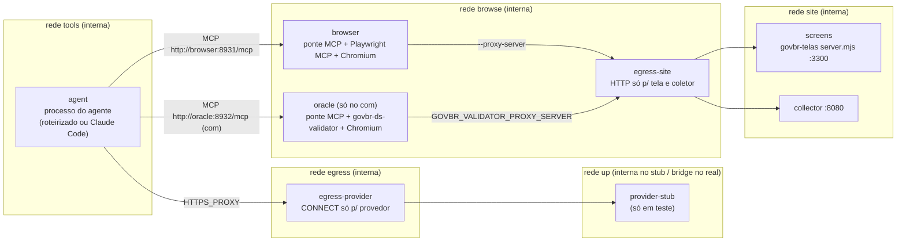

# Runner isolado de uma execução (T3a)

Plano: `thesis-workspace/planejamento/atual/plano-implementacao-benchmark-isolado-2026-10-02.md`,
itens T3, "Fronteiras de acesso e modelo de ameaça" e "Matriz mínima de provas". Contratos: D-64
(`contracts/`, `docs/contratos-benchmark.md`). Skill: D-68. Janela fixa: D-46/D-63 (NAT-32).

O T3a entrega a infraestrutura de **uma** execução isolada: imagens fixadas, redes, proxies, coletor,
ponte MCP com a trava da janela, sonda negativa e o comando `run-once`, tudo exercitado por um
**agente roteirizado** que não chama modelo nenhum. O cliente real (Claude Code) está instalado na
imagem e ligado ao `run-once`, mas não é executado contra o provedor: isso é o T3b.

> Um agente roteirizado prova as **paredes**, não as capacidades do cliente real. Que o Claude Code
> instalado não tenha outro caminho (ferramenta interna, subprocesso, variável, plugin) só se prova
> rodando o cliente real dentro destas paredes — ver "O que continua não verificado".

## Arquitetura

Por execução, tudo novo e rotulado `govbr.run=<runId>`; ao fim, tudo removido.



Todas as redes são `--internal` (sem rota para fora, sem DNS externo). A única exceção é a rede `up`
do proxy do provedor quando `--egress real` (padrão para `--agente claude`); com o agente roteirizado
o padrão é `--egress stub`: um dublê com os aliases `api.anthropic.com`/`platform.claude.com` numa
rede interna — o caminho permitido é provado sem tocar a internet.

### Quem alcança o quê

| Contêiner | Alcança | Não alcança (provado pela sonda e/ou pelo agente roteirizado) |
|---|---|---|
| `agent` | as duas pontes MCP; o proxy do provedor (só CONNECT para a allowlist) | internet direta (IPv4, IPv6, por nome), DNS externo, host do Docker (`host.docker.internal`, `gateway.docker.internal`, 192.168.65.x, gateways de cada rede, 172.17.0.1) em qualquer porta, loopback v4/v6, portas do painel antigo (3000/4000/4100–4102), **a tela e o coletor diretamente**, socket do Docker, HOME pessoal, sentinelas no host, saída de outra execução, escrita fora de `/out` |
| `browser` (Chromium) | só `screens:3300` e `collector:8080`, pelo `egress-site` | `file://` (recusado pela ponte), internet, host, loopback (o Playwright força o loopback pelo proxy), as próprias portas de controle, o oráculo |
| `oracle` (com) | só `screens:3300`, pelo `egress-site` (+ `GOVBR_VALIDATOR_ALLOWED_ORIGINS`) | o resto, como o navegador |
| `screens`, `collector` | nada além da rede `site` | — |

O processo do agente **não** alcança a tela nem o coletor: só o navegador alcança (a skill manda
enviar o relatório pela página do coletor). É mais estreito que "o agente alcança tela e coletor por
nomes fixos" do pedido do T3a — decisão registrada aqui; nada na tarefa precisa do caminho direto.

### Contêineres: flags comuns

`--read-only`, `--tmpfs /tmp` e `--tmpfs /home/runner` (dono 10001, modo 700), `--cap-drop ALL`,
`--security-opt no-new-privileges`, `--user 10001:10001`, `--pids-limit`, `--memory 2g`, `--init`.
Sem `--privileged`, sem rede do host, sem socket do Docker. Montagens: só a subpasta de saída de cada
papel (`/out`, escrita) e, no agente e na sonda, `/run/task` só-leitura (texto da tarefa e
configuração MCP). Nenhuma credencial em imagem ou montagem; o cliente real a recebe só por variável
de ambiente, e só com `--permitir-modelo`.

### Imagens (fixadas, sem `latest`)

Construídas por `npm run runner:imagens` (contexto montado por lista explícita); `runner/images.lock.json`
guarda o id de cada uma e as versões medidas de dentro dela. O preflight recusa imagem diferente.

| Imagem | Conteúdo |
|---|---|
| base | `node:24-bookworm-slim@sha256:0e0ff40c…` (Node 24.21.0 LTS) |
| `govbr-runner-screens` | `server.mjs`, `site/`, `site-manifest.json` do govbr-telas; o servidor recusa partir se um byte divergir |
| `govbr-runner-agent` | `@playwright/mcp@0.0.70` (o das baterias antigas) + Chromium dele, `@modelcontextprotocol/sdk@1.29.0`, `@anthropic-ai/claude-code@2.1.288` (instalado, não executado no T3a), ponte, sonda e agente roteirizado |
| `govbr-runner-oracle` | a imagem do agente + `dist/`, `data/` e `package*.json` do govbr-ds-validator (2.7.0), `npm ci --omit=dev`, Chromium do Playwright 1.61.1 |
| `govbr-runner-collector` | coletor + Ajv 8.20.0 + `common`/`findings` v1 copiados de `contracts/` |
| `govbr-runner-egress` | proxy com allowlist e o dublê do provedor (só módulos nativos) |

`govbr-telas/.node-version` passou a 24.21.0 (`export-telas-1.2.0`); `site/` saiu idêntico byte a byte.

## Allowlist do provedor

| Host | Situação |
|---|---|
| `api.anthropic.com:443` | exigido pela documentação do Claude Code ("Network access requirements"); não exercitado com o cliente real |
| `platform.claude.com:443` | **não verificado**: troca/renovação de token OAuth (assinatura); confirmar no T3b |

Fora de propósito: `claude.ai`, `claude.com` (login interativo), `downloads.claude.ai`,
`registry.npmjs.org`, `mcp-proxy.anthropic.com`, telemetria (`*.datadoghq.com`), `storage.googleapis.com`,
`github.com`. A imagem fixa `CLAUDE_CODE_DISABLE_NONESSENTIAL_TRAFFIC=1`, `DISABLE_TELEMETRY=1`,
`DISABLE_ERROR_REPORTING=1`, `DISABLE_AUTOUPDATER=1`.

## Trava da janela (D-63/NAT-32)

O Playwright MCP parte com `--viewport-size` fixo e o agente fala com ele só pela ponte
(`runner/container/bridge.mjs`), que aplica três camadas:

1. **Ferramenta ausente.** A ponte anuncia uma allowlist de 18 ferramentas do Playwright MCP.
   `browser_resize` e `browser_run_code` (código Playwright com `page`, capaz de `setViewportSize` e
   CDP) ficam ocultas, assim como `browser_file_upload`, `browser_install` e qualquer ferramenta nova de
   versões futuras. Chamá-las pelo nome devolve erro e grava `refused / ferramenta-oculta`.
2. **Tentativa indireta recusada e registrada.** `browser_evaluate` roda no contexto da página (não
   alcança o Playwright), mas o texto da função é conferido: `resizeTo`, `setViewportSize`,
   `Emulation.*`, atribuição de `zoom`, `devicePixelRatio` etc. são recusados com `refused / janela-fixa`.
3. **Medição depois de cada chamada.** A ponte mede `innerWidth × innerHeight` da página ativa depois
   de cada chamada encaminhada; qualquer diferença do tamanho fixado grava `drift`, e o check
   `janela-sem-deriva` do `isolation.json` falha. Pega o caminho que as duas primeiras camadas não previram.

Por que a ponte e não só omitir ferramentas na configuração: o registro tem de ser escrito por quem
o agente não controla, e a tentativa tem de aparecer como dado (não some silenciosamente).

**Outras larguras (meio declarado).** Uma instância do Playwright MCP por largura declarada, cada uma
com o próprio navegador de tamanho fixo; a ponte expõe `browser_select_window { width }` para trocar
a instância ativa. `{{MEIO_LARGURAS}}` é preenchido pelo runner com esse meio quando há mais de uma
largura (`runner/telas-runner.json` ou `--larguras`). As duas telas declaram hoje só 1280×900.

## Coletor

Um contêiner novo por execução, armado por ambiente com UM run id (o agente não o escolhe nem o vê
no texto da tarefa). `POST /api/submit` com o relatório; o coletor monta o envelope `findings.v1` e
o valida (schema estrito). Recibo mínimo `{ ok, receipt }`. Sem listagem nem leitura (404). Caminho
com `..`/`%2e`/`%2f`/barra invertida → 400; `x-govbr-run-id` diferente → 409; relatório idêntico ao
aceito → 200 `duplicate` (idempotente); diferente → 409 (sem sobrescrita); acima de 2 MB → 413;
JSON inválido ou fora do schema → 400 e corpo arquivado em `refused/`.

## Ciclo do `run-once`

```sh
npm run run-once -- --tela solicitacao --braco sem --agente fake --cenario honesto --limite-min 90 --saida <pasta-nova>
```

1. **Preflight** (`integrity`): Docker; id de cada imagem = lockfile; `site-manifest.json` = o
   embutido na imagem das telas; skill do pacote = skill do instrumento; texto da tarefa renderizado
   (`render-task-prompt`) sem vocabulário proibido; no com, `dist/`+`data/` do validador = o embutido;
   no `--agente claude`, `--permitir-modelo` + credencial. Falhou → `run.json` `not-run`, nenhum contêiner.
2. **Infraestrutura nova**: 5 redes internas, contêineres, prontidão pelos logs.
3. **Controles positivos do controlador**: sentinelas plantadas no host (`TCC/.govbr-sentinelas/<runId>/…`,
   arquivos falsos, apagados ao fim) legíveis pelo controlador; servidor-sentinela no loopback do host
   alcançado por um contêiner comum na rede `bridge` padrão (o alvo existe e é alcançável fora da
   política); `/etc/hostname` existe no contêiner do navegador; tela e coletor respondem pelo proxy;
   as pastas de outras execuções existem.
4. **Sonda negativa** (`probe.mjs`): mesma imagem, flags, montagens, redes e ambiente do agente; tenta
   cada capacidade proibida. Check obrigatório falho ou controle positivo falho → `not-run` /
   `isolation-failed`, o agente não parte.
5. **Agente**, com limite de relógio; estourou → `docker kill` do grupo inteiro, `interrupted/timeout`.
6. **Coleta e desmontagem**: logs, saídas de cada papel; remoção de todos os contêineres e redes
   (perfil do navegador, storage, mocks e tmpfs morrem com eles), conferida (`desmontagem`).
7. **Pacote**: `run.json`, `findings.json` (se aceito), `isolation.json`, `tool-events.ndjson`,
   `artifact-manifest.json`, `refused/`, `evidence/` (preflight, prompt, configuração MCP,
   configuração efetiva dos contêineres, logs, brutos de cada papel). Validado com `validateContract`
   e `crossCheckRun`; problema → código 2.

Códigos de saída: 0 passed, 3 failed/interrupted, 4 not-run, 2 pacote inválido, 1 erro de uso.
Execução do agente roteirizado grava `fixture: true` (nunca dado científico).

## Testes

`npm run test:runner` (Docker obrigatório; sem Docker, pula com aviso). Casos, nos dois braços onde
faz sentido: honesto (1 achado), vazio (`findings: []`), sem envio (`none`/`no-submission`),
malformado (recusado, corpo arquivado), proibido (cada tentativa recusada e registrada pela ponte,
pelos proxies e pelo coletor; controles positivos), estado entre execuções (marcador em
localStorage, cookie, `/tmp` e HOME da 1ª ausente na 2ª; impressão digital inicial igual), limite de
tempo (grupo morto, evidência preservada), larguras declaradas, preflight falho (nenhum contêiner),
cliente real sem autorização, saída real do proxy do provedor, e paridade entre braços (texto igual
byte a byte; configuração efetiva de todos os contêineres igual; o com só acrescenta o contêiner e a
entrada MCP do oráculo; `run.json` difere só na allowlist).

## O que o T3a provou e o que continua não verificado

Provado (com o agente roteirizado, pelo caminho completo e pelos registros do harness): as paredes de
rede e de arquivo dos contêineres, a allowlist dos dois proxies, a trava da janela nas três camadas,
a ausência do oráculo no sem (inventário, DNS, ponte e chamadas), o contrato do coletor, o reset de
estado entre execuções, o limite de tempo e o pacote validado.

Não verificado até o T3b e a prova controlada com o cliente real:

1. Capacidades efetivas do Claude Code 2.1.288 nestas paredes: ferramentas internas (Bash, Read,
   Write, WebFetch, Task…) realmente desligadas por `--disallowedTools`/`--allowedTools`; nenhum
   plugin, skill, MCP de conector ou configuração herdada (`--strict-mcp-config`, `--setting-sources ""`).
2. Que o cliente real usa só os hosts da allowlist (e se `platform.claude.com` é necessário com o
   token de assinatura); túnel permitido até o provedor real nunca aberto no T3a.
3. Cliente MCP HTTP do Claude Code falando com a ponte (o roteirizado usa o SDK MCP 1.29.0).
4. Identidade do modelo resolvido, tokens, turnos e custo (`model.resolved` fica `unknown`).
5. Erros de ferramenta do lado do cliente (timeout, `isError`, truncamento) e a reação a 429.
6. Montagem do texto da tarefa como entrada do cliente (`-p` + stdin) e o gate de aderência do
   oráculo com chamadas reais.
7. Prova de isolamento com o cliente real antes do piloto (plano, T5), sem reutilizar a sessão dela.
